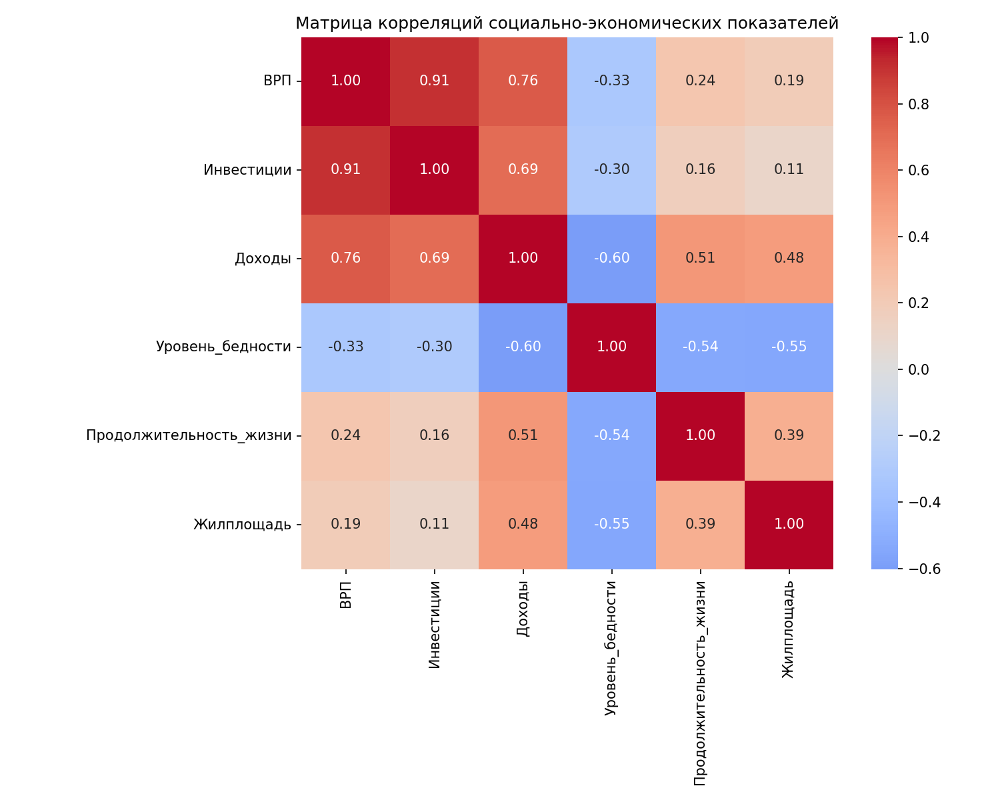
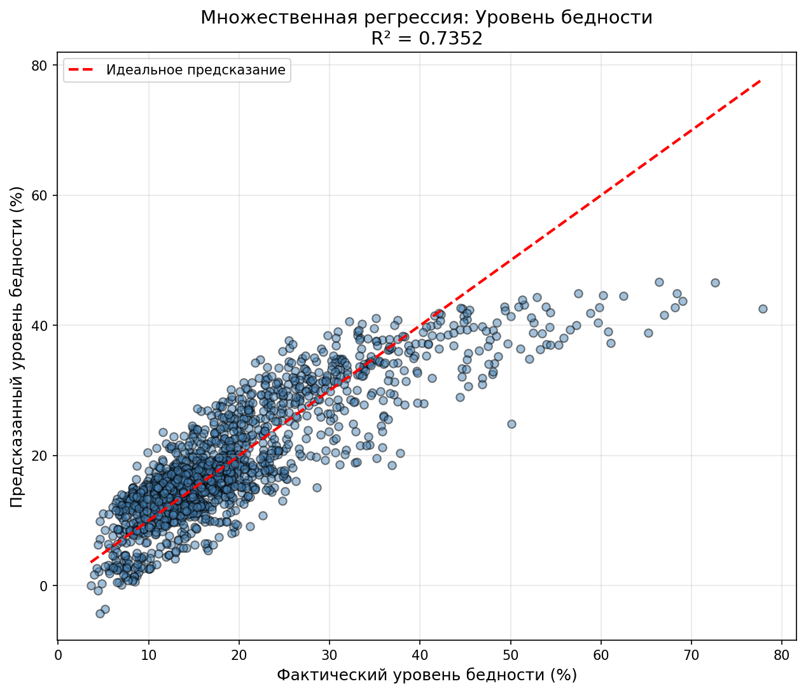

# 📈 Socio-Economic Factors Analysis

Исследование взаимосвязей факторов социально-экономического развития регионов России: как **ВРП**, **инвестиции в основной капитал** и **денежные доходы населения** связаны с социальными показателями — **продолжительностью жизни**, **уровнем бедности** и **обеспеченностью жильём**.

## 🗂 Данные

Источник — сборник Росстата **«Регионы России. Социально-экономические показатели» (2025)**, подробности в [`data/SOURCES.md`](data/SOURCES.md).

| Каталог | Содержимое |
|---|---|
| [`data/raw`](data/raw) | исходные разделы сборника (XLSX): население, уровень жизни, здравоохранение, ВРП, основные фонды, инвестиции и др. |
| [`data/processed`](data/processed) | показатели по регионам и годам в CSV и итоговый набор `final_dataset_clean.csv` |

Итоговый набор: `Регион, Год, ВРП, Инвестиции, Доходы, Уровень_бедности, Продолжительность_жизни, Жилплощадь`.

## ⚙️ Скрипты

| Скрипт | Назначение |
|---|---|
| `scripts/load_gdp.py`, `load_investments.py`, `load_income.py` | извлечение факторных признаков из XLSX |
| `scripts/load_life.py`, `load_poverty.py`, `load_housing.py` | извлечение социальных показателей |
| `scripts/load_data.py` | объединение и очистка данных |
| `scripts/model_description.py` | описательная статистика и множественная регрессия |

## 📊 Результаты

Модель: `y = b0 + b1·ln(ВРП) + b2·ln(Инвестиции) + b3·ln(Доходы) + b4·Год`

| Социальный показатель | R² |
|---|---|
| Уровень бедности | **0.735** |
| Продолжительность жизни | 0.522 |
| Жилищная площадь | 0.452 |

Сильнее всего факторами объясняется **уровень бедности**: рост доходов населения — главный фактор его снижения. Таблица коэффициентов — [`results/tables/multiple_regression_results.csv`](results/tables/multiple_regression_results.csv).

  
  

Остальные графики (распределения, диаграммы размаха, Q-Q, продолжительность жизни) — в [`results/figures`](results/figures).
