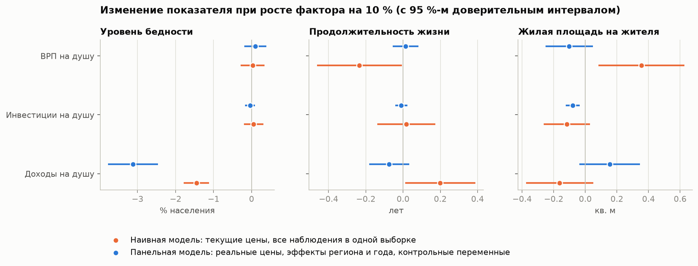
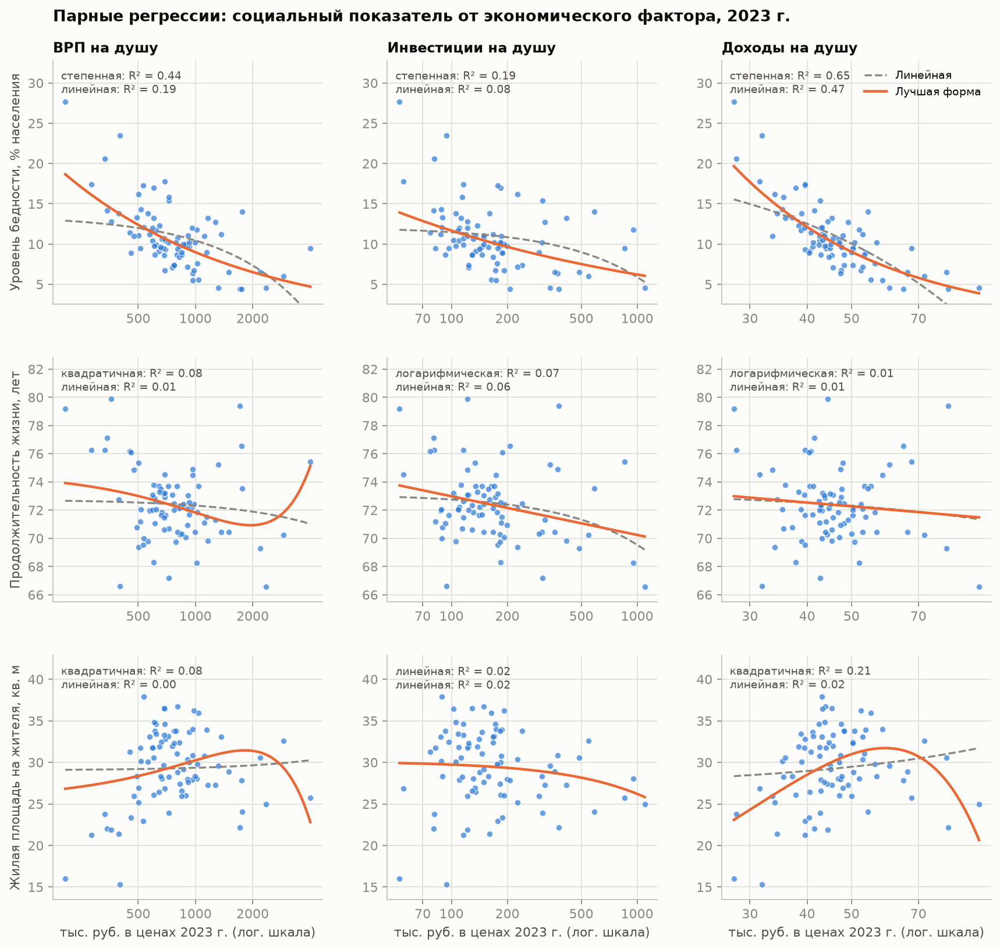
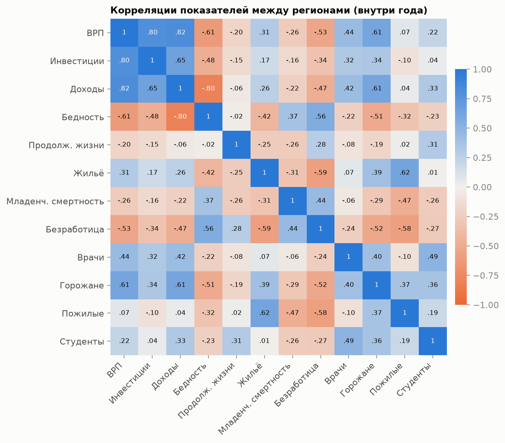
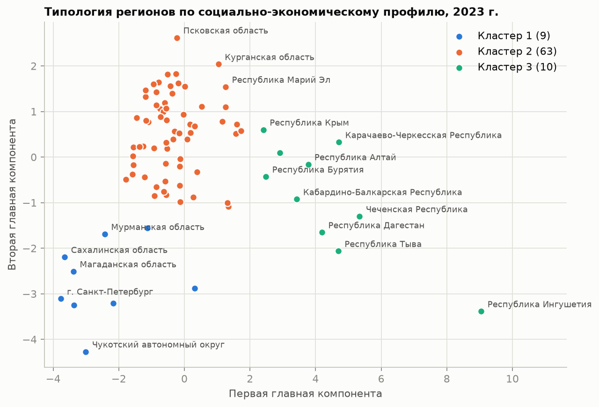

# 📈 Socio-Economic Factors Analysis


Эмпирическое исследование: связано ли улучшение жизни в регионах России с ростом их экономики. Панель **82 регионов за 2000–2023 годы** собрана из официальных таблиц Росстата; проверяется, как **ВРП**, **инвестиции** и **доходы населения** связаны с **бедностью**, **продолжительностью жизни** и **обеспеченностью жильём**.

| | |
|---|---|
| 📄 **[Текст исследования](results/REPORT.md)** | гипотезы, формулы методов, 29 таблиц, 15 графиков, трактовка каждого результата |
| 📚 **[Документация](docs/README.md)** | данные, устройство кода, запуск, каталог результатов |
| 🖥 **Интерактивная панель** | `streamlit run app.py` |

Всё пересчитывается одной командой из исходных XLSX: `python -m regions`.

## 🔎 Главные результаты

**1. С бедностью устойчиво связаны только доходы.** Рост реальных доходов на 1 % снижает уровень бедности на **1,2 %** (эластичность −1,18; на 10 % роста — 3,1 п. п. в среднем за период). Результат сохраняется во всех восьми вариантах модели. ВРП и инвестиции при тех же доходах с бедностью не связаны.

**2. Продолжительность жизни экономикой региона не объясняется.** Простая регрессия даёт R² = 0,52 и «значимый» эффект доходов, но это общий тренд: после учёта особенностей региона и года факторы объясняют около **1 %** вариации, ни один коэффициент не значим.

**3. Обеспеченность жильём определяется демографией, а не экономикой:** больше всего жилья на человека там, где население стареет и убывает (r = +0,78 с долей пожилых).

**4. Социальное благополучие не одномерно.** По ВРП, инвестициям и доходам регионы выстраиваются почти одинаково (коэффициент конкордации Кендалла 0,81), а по бедности, продолжительности жизни и жилью — несогласованно (0,42, незначим).

**5. Регионы сблизились по доходам, но не по производству.** По доходам β-сходимость значима (2,9 % в год, разрыв сокращается вдвое за 24 года) и остановилась после 2012 года; по ВРП её нет.

**6. Без поправки на цены и панельной структуры выводы ложны.** Номинальные доходы выросли в 23,5 раза, реальные — в 2,5; наивная модель занижала эффект доходов на бедность вдвое и «находила» влияние на продолжительность жизни.

<p align="center">
  
</p>

## 🧭 Как построено исследование

| Шаг | Вопрос | Метод | Раздел отчёта |
|---|---|---|---|
| 1 | Как устроены данные | Описательная статистика, критерий Шапиро — Уилка | [3](results/REPORT.md#3-разведочный-анализ) |
| 2 | Сближаются ли регионы | σ- и β-сходимость | [4](results/REPORT.md#4-сходимость-регионов) |
| 3 | Есть ли связь | Корреляции Пирсона, Спирмена и Кендалла, частные корреляции, коэффициент конкордации | [5](results/REPORT.md#5-корреляционный-анализ) |
| 4 | Какой она формы | Парные регрессии пяти видов, эластичность | [6](results/REPORT.md#6-парная-регрессия) |
| 5 | Вклад каждого фактора | Множественная регрессия, тесты предпосылок МНК | [7](results/REPORT.md#7-множественная-регрессия) |
| 6 | Сохраняется ли связь во времени | Панельная регрессия с фиксированными эффектами, тесты Фишера и Мундлака, проверка устойчивости | [8](results/REPORT.md#8-панельная-регрессия) |
| 7 | Какие бывают регионы | Кластеризация k-средних, главные компоненты | [9](results/REPORT.md#9-типология-регионов) |

<p align="center">
  
</p>

<p align="center">
  
  
</p>

## 🗂 Данные

Источник — Росстат, приложение к сборнику **«Регионы России. Социально-экономические показатели»** (2025): [страница публикации](https://rosstat.gov.ru/folder/210/document/47652), архив `Pril_Region_Pokaz_2025.rar`. Точная ссылка и перечень использованных таблиц — в [`data/SOURCES.md`](data/SOURCES.md), описание всех столбцов — в [`docs/DATA.md`](docs/DATA.md).

| Каталог | Содержимое |
|---|---|
| [`data/raw`](data/raw) | 20 разделов сборника в XLSX, без изменений |
| [`data/processed/panel.csv`](data/processed/panel.csv) | панель «регион × год»: 82 региона, 2000–2023, 1940 строк, 12 показателей |
| [`data/processed/russia.csv`](data/processed/russia.csv) | те же показатели по России в целом |

Денежные показатели пересчитаны в цены 2023 года через стоимость фиксированного набора товаров и услуг в регионе — это убирает и инфляцию, и разницу цен между регионами.

## 🚀 Запуск

```bash
python -m venv .venv
.venv\Scripts\activate            # Linux/macOS: source .venv/bin/activate
pip install -r requirements.txt

python -m regions                 # данные -> анализ -> модели -> графики -> отчёт
streamlit run app.py              # интерактивная панель
pytest                            # проверки
```

Подробнее — в [`docs/USAGE.md`](docs/USAGE.md).

## ⚙️ Структура

| Путь | Назначение |
|---|---|
| [`regions/indicators.py`](regions/indicators.py) | перечень показателей: раздел сборника, лист, единицы |
| [`regions/loader.py`](regions/loader.py) | чтение таблиц Росстата, очистка названий регионов |
| [`regions/dataset.py`](regions/dataset.py) | сборка панели и пересчёт в реальные цены |
| [`regions/analysis.py`](regions/analysis.py) | проверки распределений, корреляции, парные и множественные регрессии, тесты, сходимость |
| [`regions/models.py`](regions/models.py) | панельные модели с фиксированными эффектами |
| [`regions/clusters.py`](regions/clusters.py) | типология регионов |
| [`regions/plots.py`](regions/plots.py) | графики |
| [`regions/report.py`](regions/report.py) | сборка текста исследования |
| [`app.py`](app.py) | интерактивная панель на Streamlit |
| [`tests`](tests) | проверки данных и расчётов |
| [`docs`](docs) | документация |
| [`results`](results) | отчёт, графики и таблицы — создаются кодом |

Устройство кода и поток данных — в [`docs/ARCHITECTURE.md`](docs/ARCHITECTURE.md).

## ⚠️ Ограничения

- **Связи, а не доказанные причины.** Панельная модель снимает постоянные различия регионов и общие шоки, но не обратную причинность и не пропущенные переменные, меняющиеся во времени.
- **Бедность и доходы связаны по определению;** содержательны величина эластичности, её устойчивость и то, что остальные факторы ничего не добавляют.
- **Методика Росстата менялась** (доходы — с 2013 года, граница бедности — с 2021-го); общие сдвиги поглощаются эффектами года.
- **Дефлятор приближённый:** потребительские цены на декабрь, применённые в том числе к ВРП и инвестициям.
- **Границы между типами регионов размыты** (силуэт около 0,4).

Полный разбор — в [разделе 10.3 отчёта](results/REPORT.md#103-ограничения).
