# Экономические факторы и качество жизни в регионах России, 2000–2023

*Эмпирическое исследование по данным Росстата. Текст собирается командой `python -m regions`:
все числа, таблицы и графики получены расчётом из `data/raw`.*

## Аннотация

Исследуется связь ВРП, инвестиций и доходов населения с уровнем бедности, ожидаемой продолжительностью
жизни и обеспеченностью жильём по панели 82 регионов России за 2000–2023 годы
(1940 наблюдений). Денежные показатели приведены к ценам 2023 года с поправкой на региональный
уровень цен. Последовательно применены корреляционный анализ (коэффициенты Пирсона, Спирмена, Кендалла,
частные корреляции, коэффициент конкордации), парные регрессии пяти функциональных форм,
множественная регрессия с проверкой предпосылок МНК и панельная регрессия с фиксированными эффектами
региона и года. Установлено, что с бедностью устойчиво связаны только доходы населения: эластичность
равна −1,18, а ВРП и инвестиции при контроле доходов незначимы. Связь экономических факторов
с продолжительностью жизни, заметная в простых моделях (R² = 0,52), оказывается
следствием общего тренда: после его устранения факторы объясняют около 1 % вариации.
Регионы сближались по доходам, но не по ВРП. Выделены три типа регионов.

**Содержание:** [1. Введение](#1-введение) · [2. Данные](#2-данные) · [3. Разведочный анализ](#3-разведочный-анализ) ·
[4. Сходимость](#4-сходимость-регионов) · [5. Корреляции](#5-корреляционный-анализ) ·
[6. Парная регрессия](#6-парная-регрессия) · [7. Множественная регрессия](#7-множественная-регрессия) ·
[8. Панельная регрессия](#8-панельная-регрессия) · [9. Типология](#9-типология-регионов) ·
[10. Обсуждение](#10-обсуждение-результатов) · [11. Выводы](#11-выводы)

## 1. Введение

### 1.1. Постановка задачи

За 2000–2023 годы экономика российских регионов сильно выросла: ВРП на душу населения
в медианном регионе увеличился в реальном выражении в 2,8 раза.
За то же время бедность в стране снизилась с 29,0 % до 8,3 %,
ожидаемая продолжительность жизни выросла с 65,3 до 73,4 года,
обеспеченность жильём — с 19,2 до 28,8 кв. м на человека.

Одновременный рост ещё не означает связи. Вопрос исследования: **связано ли улучшение социальных
показателей региона с ростом его экономики, или оно шло по всей стране независимо от того,
как развивался конкретный регион?**

### 1.2. Гипотезы

| | Гипотеза |
|---|---|
| **H1** | Чем выше ВРП, инвестиции и доходы на душу населения, тем ниже уровень бедности; сильнее всего бедность связана с доходами |
| **H2** | Чем выше экономические показатели региона, тем выше ожидаемая продолжительность жизни |
| **H3** | Чем выше экономические показатели региона, тем больше жилой площади приходится на жителя |
| **H4** | Регионы сближаются по уровню экономического развития: бедные растут быстрее богатых |

### 1.3. Логика исследования

| Шаг | Вопрос | Метод | Раздел |
|---|---|---|---|
| 1 | Как устроены данные, можно ли применять параметрические методы | Описательная статистика, критерий Шапиро — Уилка | 3 |
| 2 | Сближаются ли регионы | σ- и β-сходимость | 4 |
| 3 | Есть ли связь и насколько она тесная | Коэффициенты Пирсона, Спирмена и Кендалла, частные корреляции, коэффициент конкордации | 5 |
| 4 | Какой формы связь | Парные регрессии пяти видов, эластичность | 6 |
| 5 | Каков вклад каждого фактора при прочих равных | Множественная регрессия, проверка предпосылок МНК | 7 |
| 6 | Сохраняется ли связь внутри региона во времени | Панельная регрессия с фиксированными эффектами, тесты Фишера, Мундлака, на структурный сдвиг | 8 |
| 7 | Какие типы регионов существуют | Кластеризация k-средних, главные компоненты | 9 |

## 2. Данные

### 2.1. Источник и показатели

Источник — приложение к статистическому сборнику Росстата «Регионы России. Социально-экономические
показатели» (2025), таблицы по субъектам Российской Федерации за 2000–2023 годы
([`data/SOURCES.md`](../data/SOURCES.md)).

| Обозн. | Показатель | Единица | Роль |
|---|---|---|---|
| x₁ | ВРП на душу (в ценах 2023 г.) | руб. | фактор |
| x₂ | Инвестиции на душу (в ценах 2023 г.) | руб. | фактор |
| x₃ | Доходы на душу (в ценах 2023 г.) | руб. в месяц | фактор |
| y₁ | Уровень бедности | % населения | результат |
| y₂ | Ожидаемая продолжительность жизни | лет | результат |
| y₃ | Жилая площадь на одного жителя | кв. м | результат |

Контрольные переменные: уровень безработицы, число врачей на 10 000 человек, доля городского населения,
доля населения старше трудоспособного возраста. Для описания и типологии дополнительно используются
младенческая смертность и число студентов на 10 000 человек.

### 2.2. Приведение к сопоставимым ценам

Денежные показатели в источнике даны в текущих ценах. Сравнивать их напрямую нельзя по двум причинам:
цены за 24 года выросли многократно, и в один и тот же год они сильно различаются между регионами.
Обе проблемы снимает один дефлятор — стоимость фиксированного набора потребительских товаров и услуг
$C_{it}$, которую Росстат рассчитывает для каждого региона $i$ и года $t$:

$$
P_{it} = \frac{C_{it}}{C_{\text{РФ},\,2023}}, \qquad x^{\text{реал}}_{it} = \frac{x_{it}}{P_{it}}
$$

где $C_{\text{РФ},\,2023}$ — стоимость того же набора в среднем по России в 2023 году. Результат —
рубли 2023 года при среднероссийском уровне цен.

В 2023 году индекс $P$ менялся от 0,85 (Астраханская область) до 1,65
(Чукотский автономный округ): один и тот же набор товаров на Чукотке почти вдвое дороже, чем на юге страны.
Насколько поправка существенна, видно по России в целом: в текущих ценах среднедушевые доходы
выросли в 23,5 раза, в реальных — в 2,5 раза.

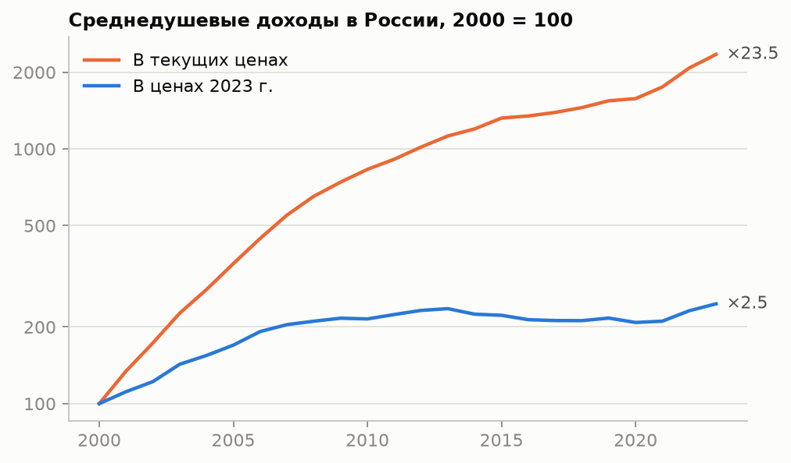

### 2.3. Выборка

Панель: **82 региона × 24 года = 1940 наблюдений**.
Автономные округа учтены в составе Архангельской и Тюменской областей, чтобы территории не пересекались.
Панель несбалансированная: по Республике Крым и Севастополю данные начинаются с 2014 года.
Пропуски в основных показателях (годы в скобках): Камчатский край (2000–2001); Республика Крым (2014); Чеченская Республика (2000–2011); г. Севастополь (2014). Строки с пропусками в переменных модели в оценивании не участвуют.

## 3. Разведочный анализ

### 3.1. Описательная статистика

Для каждого показателя рассчитаны среднее $\bar{x}$, стандартное отклонение $s$, коэффициент вариации $V$,
асимметрия $A$ и эксцесс $E$:

$$
\bar{x} = \frac{1}{n}\sum_{i=1}^{n} x_i, \qquad
s = \sqrt{\frac{1}{n-1}\sum_{i=1}^{n}(x_i-\bar{x})^2}, \qquad
V = \frac{s}{\bar{x}}\cdot 100\,\%
$$

$$
A = \frac{1}{n}\sum_{i=1}^{n}\left(\frac{x_i-\bar{x}}{s}\right)^{3}, \qquad
E = \frac{1}{n}\sum_{i=1}^{n}\left(\frac{x_i-\bar{x}}{s}\right)^{4} - 3
$$

У нормального распределения $A = 0$ и $E = 0$. Совокупность принято считать однородной при $V < 33\,\%$.

**Таблица 1. Описательная статистика, все 1940 наблюдений** (денежные показатели — в ценах 2023 г.)

| Показатель | n | Среднее | Медиана | Ст. откл. | Мин. | Макс. | V, % | A | E |
|---|---:|---:|---:|---:|---:|---:|---:|---:|---:|
| ВРП на душу (в ценах 2023 г.), руб. | 1935 | 565 697 | 488 436 | 381 473 | 54 931 | 4 022 165 | 67 | 3,27 | 16,10 |
| Инвестиции на душу (в ценах 2023 г.), руб. | 1935 | 138 466 | 110 819 | 114 218 | 8 879 | 1 097 561 | 82 | 3,32 | 15,16 |
| Доходы на душу (в ценах 2023 г.), руб. в месяц | 1928 | 36 689 | 37 393 | 11 929 | 5 816 | 94 965 | 33 | 0,40 | 0,97 |
| Уровень бедности, % населения | 1924 | 18,95 | 15,60 | 10,83 | 4,40 | 94,30 | 57 | 2,14 | 6,46 |
| Ожидаемая продолжительность жизни, лет | 1936 | 68,50 | 68,88 | 3,90 | 53,76 | 79,87 | 6 | −0,24 | 0,03 |
| Жилая площадь на одного жителя, кв. м | 1934 | 23,71 | 23,40 | 4,48 | 4,20 | 37,89 | 19 | −0,02 | 0,66 |
| Младенческая смертность, на 1000 родившихся | 1940 | 8,73 | 7,62 | 4,50 | 0,00 | 42,09 | 52 | 1,49 | 3,95 |
| Уровень безработицы, % | 1932 | 7,79 | 6,60 | 5,79 | 0,80 | 67,70 | 74 | 4,47 | 29,87 |
| Врачи на 10 000 человек, чел. | 1934 | 47,28 | 46,60 | 10,34 | 20,50 | 91,40 | 22 | 0,75 | 1,00 |
| Доля городского населения, % | 1940 | 69,50 | 70,40 | 13,07 | 26,00 | 100,00 | 19 | −0,46 | 0,91 |
| Доля населения старше трудоспособного возраста, % | 1940 | 22,00 | 23,00 | 4,99 | 6,50 | 31,20 | 23 | −0,91 | 0,52 |
| Студенты вузов на 10 000 человек, чел. | 1929 | 336,12 | 316,00 | 149,22 | 13,21 | 1 255 | 44 | 1,52 | 5,50 |

**Трактовка.**

- *Однородность.* Коэффициент вариации ниже 33 % у показателей: доходы на душу, продолжительность жизни, жилая площадь, врачи на 10 тыс., доля горожан, доля пожилых. По ним регионы
  различаются умеренно, и среднее хорошо описывает типичный регион.
  Сильнее всего регионы различаются по показателям: ВРП на душу (67 %), инвестиции на душу (82 %), уровень бедности (57 %), младенческая смертность (52 %), безработица (74 %) — здесь среднее заметно выше медианы
  и на него нельзя опираться.
- *Асимметрия.* Выраженная правосторонняя асимметрия (A > 1): ВРП на душу (A = 3,27), инвестиции на душу (A = 3,32), уровень бедности (A = 2,14), младенческая смертность (A = 1,49), безработица (A = 4,47), студенты на 10 тыс. (A = 1,52). У распределения длинный
  правый «хвост»: большинство регионов сосредоточено у нижних значений, а несколько выбиваются далеко вверх.
  По ВРП и инвестициям это ресурсные регионы и столицы, по бедности и безработице — республики Северного Кавказа и Тыва.
- *Вывод для моделей.* Показатели с длинным правым хвостом нельзя включать в регрессию в уровнях:
  несколько регионов определили бы наклон линии для всех остальных. Поэтому ВРП, инвестиции и доходы
  далее берутся в натуральных логарифмах.

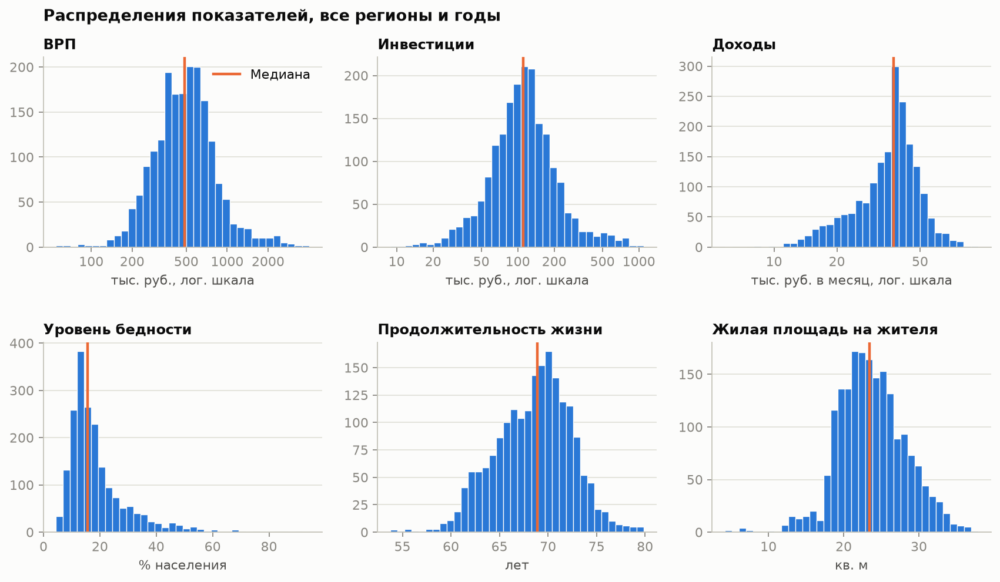

### 3.2. Проверка нормальности

Корреляция Пирсона и t-критерий предполагают распределение, близкое к нормальному. Гипотеза
$H_0$: «выборка взята из нормального распределения» проверена критерием Шапиро — Уилка на срезе 2023 года
($n = 82$); при $p < 0{,}05$ гипотеза отвергается. Статистика $W$ тем ближе к 1,
чем ближе распределение к нормальному.

**Таблица 2. Критерий Шапиро — Уилка, 2023 г.: показатели в уровнях и в логарифмах**

| Показатель | A | W | p | A (ln) | W (ln) | p (ln) |
|---|---:|---:|---:|---:|---:|---:|
| ВРП на душу | 3,06 | 0,704 | <0,001 | 0,60 | 0,964 | 0,020 |
| Инвестиции на душу | 3,08 | 0,627 | <0,001 | 1,07 | 0,926 | <0,001 |
| Доходы на душу | 1,70 | 0,871 | <0,001 | 0,68 | 0,959 | 0,010 |
| Уровень бедности | 1,43 | 0,905 | <0,001 | −0,07 | 0,978 | 0,175 |
| Продолжительность жизни | 0,52 | 0,968 | 0,041 | 0,38 | 0,974 | 0,095 |
| Жилая площадь | −0,63 | 0,971 | 0,057 | −1,27 | 0,918 | <0,001 |
| Младенческая смертность | 5,61 | 0,548 | <0,001 | 1,63 | 0,887 | <0,001 |
| Безработица | 4,89 | 0,520 | <0,001 | 1,62 | 0,873 | <0,001 |
| Врачи на 10 тыс. | 1,17 | 0,932 | <0,001 | 0,41 | 0,983 | 0,356 |
| Доля горожан | −0,47 | 0,970 | 0,052 | −1,33 | 0,909 | <0,001 |
| Доля пожилых | −1,40 | 0,883 | <0,001 | −2,20 | 0,771 | <0,001 |
| Студенты на 10 тыс. | 1,63 | 0,877 | <0,001 | −1,56 | 0,871 | <0,001 |

**Трактовка.** В уровнях нормальность не отвергается только у показателей: жилая площадь, доля горожан.
У трёх экономических факторов распределение далеко от нормального (W от 0,63 до 0,87).
Логарифмирование приближает их к нормальному — W растёт до 0,93–0,96,
асимметрия падает с 1,7–3,1 до 0,6–1,1, —
но полностью нормальным не делает. Отсюда два решения: факторы используются в логарифмах, а выводы
по корреляции Пирсона дублируются ранговым коэффициентом Спирмена, который нормальности не требует.

### 3.3. Динамика

**Таблица 3. Медианный регион по годам**

| Показатель | 2000 | 2005 | 2010 | 2015 | 2020 | 2023 | Рост, раз |
|---|---:|---:|---:|---:|---:|---:|---:|
| ВРП на душу, руб. | 260 237 | 364 817 | 450 240 | 530 987 | 596 391 | 726 224 | 2,79 |
| Инвестиции на душу, руб. | 54 532 | 84 450 | 119 386 | 115 657 | 123 091 | 148 924 | 2,73 |
| Доходы на душу, руб. в месяц | 16 745 | 27 592 | 38 164 | 41 079 | 38 335 | 44 782 | 2,67 |
| Уровень бедности, % населения | 40,7 | 20,7 | 15,0 | 14,4 | 13,2 | 10,2 | 0,25 |
| Продолжительность жизни, лет | 64,9 | 64,4 | 68,2 | 70,4 | 70,7 | 72,1 | 1,11 |
| Жилая площадь, кв. м | 19,4 | 21,0 | 23,0 | 24,9 | 27,6 | 29,7 | 1,53 |

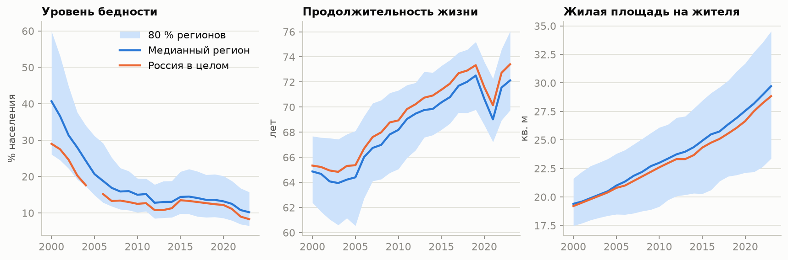

**Трактовка.** Все шесть показателей менялись в одну сторону: экономические выросли в 2,7–2,8 раза
в реальном выражении, бедность упала вчетверо, продолжительность жизни выросла на 7,3 года.
Это главная методическая ловушка исследования: любые два растущих ряда коррелируют между собой, даже если
никак не связаны. Основной рост доходов пришёлся на 2000–2012 годы, после чего реальные доходы почти не менялись,
а социальные показатели продолжали улучшаться — первый признак того, что они зависят не только от экономики.
Провал продолжительности жизни в 2020–2021 годах общий для всех регионов.

### 3.4. Территориальные различия

**Таблица 4. Крайние значения социальных показателей, 2023 г.**

| Показатель | Наибольшие значения | Наименьшие значения |
|---|---|---|
| Уровень бедности, % населения | Республика Ингушетия — 27,7; Республика Тыва — 23,5; Карачаево-Черкесская Республика — 20,6; Республика Калмыкия — 17,8; Чеченская Республика — 17,4 | г. Москва — 4,4; г. Санкт-Петербург — 4,4; Республика Татарстан — 4,6; Чукотский автономный округ — 4,6; Московская область — 5,5 |
| Продолжительность жизни, лет | Республика Дагестан — 79,9; г. Москва — 79,4; Республика Ингушетия — 79,2; Кабардино-Балкарская Республика — 77,1; г. Санкт-Петербург — 76,5 | Чукотский автономный округ — 66,6; Республика Тыва — 66,6; Забайкальский край — 67,2; Амурская область — 68,2; Еврейская автономная область — 68,3 |
| Жилая площадь, кв. м | Псковская область — 37,9; Новгородская область — 36,7; Тверская область — 36,5; Рязанская область — 36,4; Липецкая область — 36,2 | Республика Тыва — 15,3; Республика Ингушетия — 16,0; Чеченская Республика — 21,2; Республика Крым — 21,4; Республика Дагестан — 21,9 |

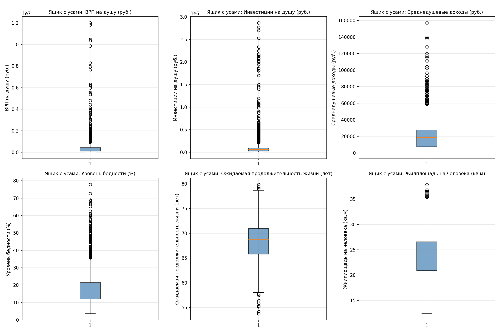

**Трактовка.** Списки лидеров и аутсайдеров по трём показателям не совпадают. Ингушетия — регион с самой
высокой бедностью и одновременно в тройке лидеров по продолжительности жизни; Чукотка — в числе регионов
с самой низкой бедностью и на последнем месте по продолжительности жизни. Самая большая обеспеченность жильём — не в богатых
регионах, а в областях Центра и Северо-Запада с убывающим населением. Уже на этом этапе видно, что
гипотезы H2 и H3 в простой форме могут не подтвердиться.

## 4. Сходимость регионов

### 4.1. σ-сходимость

σ-сходимость означает, что разброс показателя между регионами со временем уменьшается. Мера разброса —
коэффициент вариации в году $t$:

$$
V_t = \frac{s_t}{\bar{x}_t}\cdot 100\,\%
$$

Если $V_t$ убывает, регионы сближаются.

**Таблица 5. Коэффициент вариации между регионами, %**

| Показатель | 2000 | 2004 | 2008 | 2012 | 2016 | 2020 | 2023 |
|---|---:|---:|---:|---:|---:|---:|---:|
| Доходы, текущие цены | 56,2 | 53,1 | 37,7 | 34,5 | 34,6 | 39,9 | 42,7 |
| Доходы, реальные | 34,1 | 31,3 | 21,9 | 19,7 | 20,1 | 22,7 | 24,2 |
| ВРП, реальный | 56,8 | 57,9 | 55,2 | 55,5 | 53,0 | 56,6 | 64,9 |
| Бедность | 33,2 | 36,6 | 31,0 | 31,7 | 34,0 | 34,9 | 37,4 |
| Продолж. жизни | 3,9 | 4,9 | 4,2 | 3,8 | 3,4 | 3,0 | 3,6 |

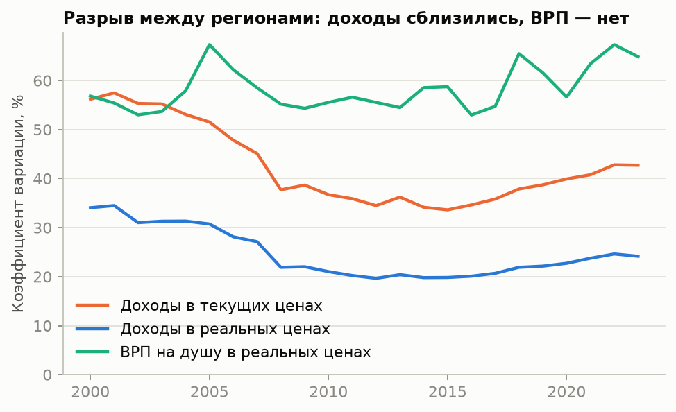

**Трактовка.** По реальным доходам разброс сократился с 34,1 % до
19,7 % к 2012 году — регионы заметно сблизились. После этого сближение
остановилось, и к 2023 году разброс вырос до 24,2 %.
По ВРП на душу сходимости нет вовсе: 56,8 % в начале периода и
64,9 % в конце. Регионы стали ближе по тому, сколько получают жители,
но не по тому, сколько производят, — различие, которое указывает на роль перераспределения
(зарплаты бюджетников, пенсии, трансферты). Поправка на цены сама по себе сокращает видимое неравенство
почти вдвое: в текущих ценах коэффициент вариации доходов в 2023 году равен 42,7 %.

### 4.2. β-сходимость

β-сходимость означает, что регионы с низким исходным уровнем растут быстрее. Проверяется регрессией
среднегодового темпа роста на логарифм исходного уровня (Барро и Сала-и-Мартин):

$$
\frac{1}{T}\ln\frac{y_{i,T}}{y_{i,0}} = a + b\,\ln y_{i,0} + \varepsilon_i
$$

Сходимость есть, если $b < 0$ и коэффициент значим. По $b$ рассчитываются скорость сходимости $\lambda$
и время, за которое разрыв сокращается вдвое:

$$
\lambda = -\frac{\ln(1 + bT)}{T}, \qquad t_{1/2} = \frac{\ln 2}{\lambda}
$$

**Таблица 6. β-сходимость за 2000–2023 гг.** (T = 23, робастные ошибки HC3)

| Показатель | n | a | b | Ст. ош. | p | R² | λ, % в год | t½, лет |
|---|---:|---:|---:|---:|---:|---:|---:|---:|
| Реальные доходы | 79 | 0,2477 | −0,0210 | 0,0025 | <0,001 | 0,47 | 2,86 | 24 |
| Реальный ВРП на душу | 79 | 0,1067 | −0,0048 | 0,0026 | 0,064 | 0,04 | 0,51 | 136 |

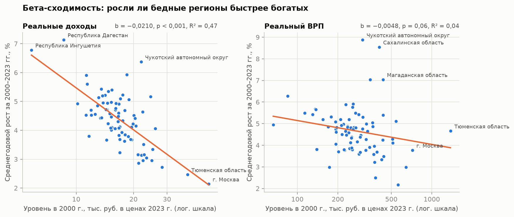

**Трактовка.** По доходам сходимость подтверждается: b = −0,0210 (p < 0,001), исходный уровень
объясняет 47 % различий в темпах роста. Регион, который в 2000 году был вдвое беднее,
рос в среднем на 1,5 п. п. в год быстрее. Скорость сходимости 2,9 % в год:
разрыв сокращается вдвое примерно за 24 года.
По ВРП коэффициент b = −0,0048 статистически незначим на уровне 5 % (p = 0,064), а R² равен
всего 0,04: бедные по ВРП регионы не росли систематически быстрее богатых.

**Гипотеза H4 подтверждается частично:** сходимость есть по доходам (и остановилась после 2012 года),
по производству её нет.

## 5. Корреляционный анализ

### 5.1. Методика

Теснота линейной связи измеряется коэффициентом Пирсона:

$$
r_{xy} = \frac{\sum_{i=1}^{n}(x_i-\bar{x})(y_i-\bar{y})}{\sqrt{\sum_{i=1}^{n}(x_i-\bar{x})^2\,\sum_{i=1}^{n}(y_i-\bar{y})^2}}
$$

Значимость проверяется t-критерием Стьюдента с $n-2$ степенями свободы ($H_0$: $r = 0$):

$$
t = r\,\sqrt{\frac{n-2}{1-r^2}}
$$

Доверительный интервал для $r$ строится через z-преобразование Фишера: величина $z$ распределена
приблизительно нормально со стандартной ошибкой $1/\sqrt{n-3}$, границы интервала переводятся обратно
гиперболическим тангенсом:

$$
z = \frac{1}{2}\ln\frac{1+r}{1-r}, \qquad
r_{\text{н},\,\text{в}} = \operatorname{th}\left(z \mp \frac{1{,}96}{\sqrt{n-3}}\right)
$$

Поскольку распределения отклоняются от нормального (раздел 3.2), дополнительно рассчитаны два ранговых
коэффициента, не требующих нормальности. Коэффициент Спирмена, где $d_i$ — разность рангов региона
по двум показателям:

$$
\rho = 1 - \frac{6\sum_{i=1}^{n} d_i^{2}}{n(n^2-1)}
$$

Коэффициент Кендалла сравнивает все пары регионов: $P$ — число пар, в которых оба показателя упорядочены
одинаково, $Q$ — в которых противоположно (используется вариант $\tau_b$ с поправкой на совпадающие ранги):

$$
\tau = \frac{P - Q}{\tfrac{1}{2}\,n(n-1)}
$$

$\tau$ имеет прямой смысл — это разность вероятностей согласованного и несогласованного порядка в случайной
паре регионов — и наименее чувствителен к выбросам. По модулю он обычно меньше $\rho$; вывод считается
надёжным, когда все три коэффициента согласны в знаке и значимости.

**Частная корреляция** показывает связь фактора с показателем при неизменных остальных факторах.
Для одного исключаемого фактора $z$:

$$
r_{xy\cdot z} = \frac{r_{xy} - r_{xz}\,r_{yz}}{\sqrt{(1-r_{xz}^2)(1-r_{yz}^2)}}
$$

При исключении $k$ факторов она равна корреляции остатков регрессий $x$ и $y$ на эти факторы, а значимость
проверяется t-критерием с $n-k-2$ степенями свободы.

**Коэффициент конкордации Кендалла** измеряет согласованность сразу нескольких ранжирований. Если $m$
показателей ранжируют $n$ регионов, $R_i$ — сумма рангов региона $i$, то

$$
W = \frac{12\sum_{i=1}^{n}(R_i-\bar{R})^2}{m^2(n^3-n)}, \qquad \chi^2 = m(n-1)\,W
$$

$W = 1$ при полном совпадении ранжирований и $W = 0$ при их независимости; статистика $\chi^2$ имеет
$n-1$ степень свободы. Средний коэффициент Спирмена между парами показателей равен $(mW-1)/(m-1)$.

Теснота связи оценивается по шкале Чеддока: до 0,3 — слабая, 0,3–0,5 — умеренная, 0,5–0,7 — заметная,
0,7–0,9 — высокая, выше 0,9 — весьма высокая.

Корреляции считаются двумя способами. **На срезе одного года** — чтобы связь не подменялась общим трендом.
**По всей панели после вычитания среднего за год** — чтобы использовать все наблюдения:

$$
\tilde{x}_{it} = x_{it} - \bar{x}_{t}
$$

где $\bar{x}_{t}$ — среднее по регионам в году $t$.

### 5.2. Корреляции на срезе 2023 года

При $n = 82$ критическое значение $t_{0{,}05;\,80} = 1,99$, поэтому значимы коэффициенты, по модулю
превышающие 0,22. Экономические факторы взяты в логарифмах (на ранговые коэффициенты ρ и τ это не влияет).

**Таблица 7. Связь факторов с социальными показателями, 2023 г.**

| Показатель | Фактор | r | 95 %-й интервал r | t | p | ρ | p (ρ) | τ | p (τ) | Связь |
|---|---|---:|---:|---:|---:|---:|---:|---:|---:|---:|
| Уровень бедности | ВРП на душу | −0,62 | −0,74…−0,47 | −7,08 | <0,001 | −0,57 | <0,001 | −0,41 | <0,001 | заметная |
| Уровень бедности | Инвестиции на душу | −0,42 | −0,59…−0,23 | −4,20 | <0,001 | −0,44 | <0,001 | −0,32 | <0,001 | умеренная |
| Уровень бедности | Доходы на душу | −0,76 | −0,84…−0,65 | −10,43 | <0,001 | −0,73 | <0,001 | −0,56 | <0,001 | высокая |
| Уровень бедности | Безработица | 0,68 | 0,54…0,78 | 8,21 | <0,001 | 0,52 | <0,001 | 0,37 | <0,001 | заметная |
| Уровень бедности | Врачи на 10 тыс. | −0,30 | −0,49…−0,09 | −2,85 | 0,006 | −0,20 | 0,071 | −0,14 | 0,065 | умеренная |
| Уровень бедности | Доля горожан | −0,61 | −0,73…−0,45 | −6,86 | <0,001 | −0,55 | <0,001 | −0,40 | <0,001 | заметная |
| Уровень бедности | Доля пожилых | −0,52 | −0,66…−0,34 | −5,48 | <0,001 | −0,33 | 0,002 | −0,23 | 0,002 | заметная |
| Продолжительность жизни | ВРП на душу | −0,24 | −0,43…−0,02 | −2,18 | 0,032 | −0,20 | 0,074 | −0,14 | 0,057 | слабая |
| Продолжительность жизни | Инвестиции на душу | −0,27 | −0,46…−0,06 | −2,53 | 0,013 | −0,23 | 0,034 | −0,16 | 0,031 | слабая |
| Продолжительность жизни | Доходы на душу | −0,10 | −0,31…0,12 | −0,92 | 0,360 | −0,08 | 0,483 | −0,05 | 0,481 | незначима |
| Продолжительность жизни | Безработица | 0,37 | 0,16…0,54 | 3,55 | <0,001 | 0,01 | 0,914 | −0,01 | 0,946 | умеренная |
| Продолжительность жизни | Врачи на 10 тыс. | 0,01 | −0,21…0,22 | 0,06 | 0,951 | −0,08 | 0,491 | −0,05 | 0,478 | незначима |
| Продолжительность жизни | Доля горожан | −0,16 | −0,36…0,06 | −1,44 | 0,154 | −0,23 | 0,034 | −0,18 | 0,018 | незначима |
| Продолжительность жизни | Доля пожилых | −0,09 | −0,30…0,13 | −0,76 | 0,447 | −0,01 | 0,964 | −0,01 | 0,917 | незначима |
| Жилая площадь | ВРП на душу | 0,23 | 0,02…0,43 | 2,14 | 0,035 | 0,16 | 0,153 | 0,10 | 0,170 | слабая |
| Жилая площадь | Инвестиции на душу | −0,09 | −0,30…0,13 | −0,84 | 0,404 | −0,16 | 0,159 | −0,11 | 0,153 | незначима |
| Жилая площадь | Доходы на душу | 0,21 | 0,00…0,41 | 1,96 | 0,053 | 0,21 | 0,053 | 0,15 | 0,051 | незначима |
| Жилая площадь | Безработица | −0,50 | −0,65…−0,32 | −5,23 | <0,001 | −0,25 | 0,021 | −0,17 | 0,029 | заметная |
| Жилая площадь | Врачи на 10 тыс. | −0,08 | −0,29…0,14 | −0,69 | 0,492 | −0,06 | 0,573 | −0,04 | 0,570 | незначима |
| Жилая площадь | Доля горожан | 0,29 | 0,08…0,48 | 2,75 | 0,007 | 0,20 | 0,075 | 0,12 | 0,126 | слабая |
| Жилая площадь | Доля пожилых | 0,78 | 0,68…0,85 | 11,15 | <0,001 | 0,74 | <0,001 | 0,56 | <0,001 | высокая |

**Трактовка.**

- **Уровень бедности:** ВРП на душу r = −0,62 (заметная, p < 0,001); инвестиции на душу r = −0,42 (умеренная, p < 0,001); доходы на душу r = −0,76 (высокая, p < 0,001).
- **Продолжительность жизни:** ВРП на душу r = −0,24 (слабая, p = 0,032); инвестиции на душу r = −0,27 (слабая, p = 0,013); доходы на душу r = −0,10 (незначима, p = 0,360).
- **Жилая площадь:** ВРП на душу r = +0,23 (слабая, p = 0,035); инвестиции на душу r = −0,09 (незначима, p = 0,404); доходы на душу r = +0,21 (незначима, p = 0,053).

Бедность связана со всеми тремя факторами, причём теснее всего — с доходами: доходы объясняют
58 % её вариации ($r^2$), ВРП — 39 %,
инвестиции — 18 %.

Для продолжительности жизни знак связи **отрицательный**: в регионах с высоким ВРП и инвестициями живут
в среднем меньше. Это не значит, что богатство сокращает жизнь, — это эффект состава: самые высокие ВРП
и инвестиции у северных и дальневосточных сырьевых регионов с тяжёлым климатом, а самая высокая
продолжительность жизни — в небогатых республиках Северного Кавказа. С доходами связи нет вообще.

Обеспеченность жильём с экономическими факторами связана слабо, зато тесно связана с долей пожилых
(r = +0,78): жилья на человека больше там, где население стареет и убывает,
а жилой фонд остаётся.

Три коэффициента согласны в выводе о значимости в 71 % пар. Расхождения: уровень бедности — врачи на 10 тыс.; продолжительность жизни — ВРП на душу; продолжительность жизни — безработица; продолжительность жизни — доля горожан; жилая площадь — ВРП на душу; жилая площадь — доля горожан.
В этих парах связь держится на нескольких крайних регионах (коэффициент Пирсона к ним чувствителен,
ранговые — нет), и считать её установленной нельзя. Для главного результата расхождений нет: связь бедности
с доходами подтверждают все три коэффициента (r = −0,76, ρ = −0,73,
τ = −0,56), а доверительный интервал r — от −0,84
до −0,65 — целиком лежит в области заметной и высокой связи.

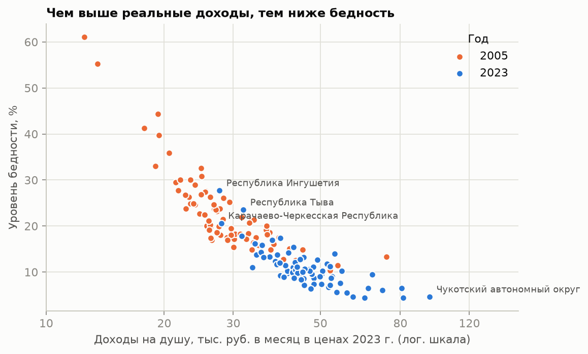

### 5.3. Частные корреляции

Парные коэффициенты смешивают собственную связь фактора с показателем и связь через другие факторы.
Частные коэффициенты рассчитаны при фиксированных двух остальных экономических факторах ($k = 2$, 78 степеней свободы).

**Таблица 8. Парные и частные корреляции, 2023 г.**

| Показатель | Фактор | Парная r | Частная r | t | p | Вывод |
|---|---|---:|---:|---:|---:|---:|
| Уровень бедности | ВРП на душу | −0,62 | −0,13 | −1,18 | 0,243 | незначима |
| Уровень бедности | Инвестиции на душу | −0,42 | 0,30 | 2,73 | 0,008 | значима |
| Уровень бедности | Доходы на душу | −0,76 | −0,60 | −6,65 | <0,001 | значима |
| Продолжительность жизни | ВРП на душу | −0,24 | −0,16 | −1,43 | 0,156 | незначима |
| Продолжительность жизни | Инвестиции на душу | −0,27 | −0,19 | −1,68 | 0,096 | незначима |
| Продолжительность жизни | Доходы на душу | −0,10 | 0,21 | 1,88 | 0,064 | незначима |
| Жилая площадь | ВРП на душу | 0,23 | 0,34 | 3,15 | 0,002 | значима |
| Жилая площадь | Инвестиции на душу | −0,09 | −0,47 | −4,73 | <0,001 | значима |
| Жилая площадь | Доходы на душу | 0,21 | 0,16 | 1,41 | 0,164 | незначима |

**Трактовка.** Связь бедности с ВРП при фиксированных доходах и инвестициях падает с −0,62
до −0,13 и перестаёт быть значимой (p = 0,243): заметная парная корреляция
была отражением связи ВРП с доходами. Связь бедности с доходами при фиксированных ВРП и инвестициях остаётся
заметной: −0,60 (p < 0,001). У инвестиций знак меняется
на положительный (0,30) — при равных доходах и ВРП бедность выше там, где инвестиций больше;
этот эффект разобран в разделе 7. Для продолжительности жизни ни одна частная корреляция не значима на уровне 5 %.

### 5.4. Согласованность ранжирований регионов

Если социальные показатели отражают общий «уровень благополучия», регионы должны выстраиваться по ним
в похожем порядке. Это проверяется коэффициентом конкордации; бедность взята с обратным знаком, чтобы
во всех показателях больший ранг означал лучшее положение.

**Таблица 9. Коэффициент конкордации Кендалла, 2023 г.** (n = 82)

| Группа показателей | m | W | χ² | p | Средний ρ |
|---|---:|---:|---:|---:|---:|
| Экономические: ВРП, инвестиции, доходы | 3 | 0,81 | 197,2 | <0,001 | 0,72 |
| Социальные: бедность, продолжительность жизни, жильё | 3 | 0,42 | 101,2 | 0,064 | 0,12 |
| Доходы и три социальных показателя | 4 | 0,41 | 131,2 | <0,001 | 0,21 |

**Трактовка.** По трём экономическим показателям ранжирования согласованы высоко: W = 0,81
(p < 0,001), средний коэффициент Спирмена между ними 0,72. Регион, богатый по ВРП,
как правило, богат и по инвестициям, и по доходам — это одно измерение. По трём социальным показателям
согласованности нет: W = 0,42, гипотеза о независимости ранжирований не отвергается
(p = 0,064), средний ρ всего 0,12. Регион, благополучный по бедности, не обязательно
благополучен по продолжительности жизни или жилью. Единого «уровня социального благополучия» в данных нет,
поэтому три показателя нельзя сводить в общий индекс и нужно моделировать по отдельности. Добавление доходов
к социальным показателям даёт W = 0,41: согласованность статистически значима, но слабая.

### 5.5. Корреляционная матрица по всей панели

**Таблица 10. Десять самых тесных связей** (отклонения от среднего за год, 1940 наблюдений)

| Показатель 1 | Показатель 2 | r | Связь |
|---|---|---:|---:|
| ВРП на душу | Доходы на душу | +0,82 | высокая |
| ВРП на душу | Инвестиции на душу | +0,80 | высокая |
| Доходы на душу | Уровень бедности | −0,80 | высокая |
| Инвестиции на душу | Доходы на душу | +0,65 | заметная |
| Жилая площадь | Доля пожилых | +0,62 | заметная |
| Доходы на душу | Доля горожан | +0,61 | заметная |
| ВРП на душу | Уровень бедности | −0,61 | заметная |
| ВРП на душу | Доля горожан | +0,61 | заметная |
| Жилая площадь | Безработица | −0,59 | заметная |
| Безработица | Доля пожилых | −0,58 | заметная |

**Трактовка.** Три экономических фактора тесно связаны между собой: ВРП и доходы — r = +0,82,
ВРП и инвестиции — r = +0,80. Для множественной регрессии это означает риск
мультиколлинеарности: модели трудно разделить вклад ВРП и доходов, поэтому в разделе 7 он проверяется отдельно.
Связь бедности с доходами (r = −0,80) по всей панели такая же, как на срезе 2023 года,
то есть она устойчива во времени. Продолжительность жизни не имеет ни одной связи теснее умеренной.

**Предварительно:** H1 согласуется с данными, H2 и H3 — нет.

## 6. Парная регрессия

### 6.1. Формы связи и критерии выбора

Корреляция показывает тесноту связи, но не её форму. Для каждой из девяти пар «фактор → показатель»
на срезе последнего года оценены пять моделей; $x$ — фактор в тыс. руб., $E$ — коэффициент эластичности
в средней точке.

| Модель | Уравнение | Оценивается как | Эластичность $E$ |
|---|---|---|---|
| Линейная | $\hat{y} = a + bx$ | МНК | $b\,\bar{x}/\bar{y}$ |
| Логарифмическая | $\hat{y} = a + b\ln x$ | МНК по $\ln x$ | $b/\bar{y}$ |
| Степенная | $\hat{y} = a\,x^{b}$ | $\ln y = \ln a + b\ln x$ | $b$ |
| Экспоненциальная | $\hat{y} = a\,e^{bx}$ | $\ln y = \ln a + bx$ | $b\,\bar{x}$ |
| Квадратичная | $\hat{y} = a + bx + cx^{2}$ | МНК | $(b + 2c\bar{x})\,\bar{x}/\bar{y}$ |

Параметры находятся методом наименьших квадратов — минимизацией суммы квадратов остатков:

$$
\sum_{i=1}^{n}(y_i - \hat{y}_i)^2 \to \min, \qquad
b = \frac{\sum (x_i-\bar{x})(y_i-\bar{y})}{\sum (x_i-\bar{x})^2}, \qquad a = \bar{y} - b\bar{x}
$$

Качество оценивается коэффициентом детерминации, скорректированным на число параметров $k$,
F-критерием Фишера и средней ошибкой аппроксимации:

$$
R^2 = 1 - \frac{\sum (y_i-\hat{y}_i)^2}{\sum (y_i-\bar{y})^2}, \qquad
\bar{R}^2 = 1 - (1-R^2)\,\frac{n-1}{n-k-1}
$$

$$
F = \frac{R^2}{1-R^2}\cdot\frac{n-k-1}{k}, \qquad
\bar{A} = \frac{1}{n}\sum_{i=1}^{n}\left|\frac{y_i-\hat{y}_i}{y_i}\right|\cdot 100\,\%
$$

Чтобы модели были сопоставимы, $R^2$ и $\bar{A}$ для степенной и экспоненциальной форм считаются
в исходных единицах $y$, а не в логарифмах. Лучшей считается форма с наибольшим $\bar{R}^2$.
Эластичность показывает, на сколько процентов меняется $y$ при росте $x$ на 1 %.

### 6.2. Результаты

**Таблица 11. Скорректированный R² по формам связи, 2023 г.** (n = 82)

| Показатель | Фактор | Линейная | Логарифмическая | Степенная | Экспоненциальная | Квадратичная |
|---|---|---:|---:|---:|---:|---:|
| Уровень бедности | ВРП на душу | 0,182 | 0,378 | 0,433 | 0,209 | 0,359 |
| Уровень бедности | Инвестиции на душу | 0,067 | 0,170 | 0,181 | 0,056 | 0,118 |
| Уровень бедности | Доходы на душу | 0,468 | 0,571 | 0,649 | 0,549 | 0,620 |
| Продолжительность жизни | ВРП на душу | −0,003 | 0,044 | 0,045 | −0,004 | 0,055 |
| Продолжительность жизни | Инвестиции на душу | 0,051 | 0,063 | 0,063 | 0,051 | 0,040 |
| Продолжительность жизни | Доходы на душу | −0,004 | −0,002 | −0,002 | −0,004 | −0,016 |
| Жилая площадь | ВРП на душу | −0,011 | 0,042 | 0,018 | −0,020 | 0,052 |
| Жилая площадь | Инвестиции на душу | 0,012 | −0,004 | −0,013 | 0,004 | 0,001 |
| Жилая площадь | Доходы на душу | 0,003 | 0,034 | 0,015 | −0,009 | 0,195 |

**Таблица 12. Лучшая модель для каждой пары**

| Показатель | Фактор | Форма | Уравнение | R² | F | p | Ā, % | E |
|---|---|---|---|---:|---:|---:|---:|---:|
| Уровень бедности | ВРП на душу | степенная | ŷ = 220,6·x^(−0,463) | 0,44 | 54,9 | <0,001 | 21,5 | −0,46 |
| Уровень бедности | Инвестиции на душу | степенная | ŷ = 41,12·x^(−0,273) | 0,19 | 20,9 | <0,001 | 24,5 | −0,27 |
| Уровень бедности | Доходы на душу | степенная | ŷ = 1544·x^(−1,314) | 0,65 | 145,2 | <0,001 | 16,7 | −1,31 |
| Продолжительность жизни | ВРП на душу | квадратичная | ŷ = 74,67 − 0,00383·x + 9,81·10⁻⁷·x² | 0,08 | 3,3 | 0,041 | 2,5 | −0,03 |
| Продолжительность жизни | Инвестиции на душу | логарифмическая | ŷ = 78,46 − 1,191·ln x | 0,07 | 6,4 | 0,013 | 2,6 | −0,02 |
| Продолжительность жизни | Доходы на душу | логарифмическая | ŷ = 77,02 − 1,216·ln x | 0,01 | 0,8 | 0,360 | 2,6 | −0,02 |
| Жилая площадь | ВРП на душу | квадратичная | ŷ = 25,57 + 0,00646·x − 1,78·10⁻⁶·x² | 0,08 | 3,2 | 0,045 | 13,3 | 0,10 |
| Жилая площадь | Инвестиции на душу | линейная | ŷ = 30,12 − 0,003909·x | 0,02 | 2,0 | 0,159 | 13,3 | −0,03 |
| Жилая площадь | Доходы на душу | квадратичная | ŷ = 1,31 + 1,027·x − 0,008669·x² | 0,21 | 10,8 | <0,001 | 12,5 | 0,34 |

### 6.3. Трактовка

**Бедность и доходы.** Лучшая форма — степенная: ŷ = 1544·x^(−1,314), R² = 0,65, F = 145,2
(p < 0,001). Модель объясняет 65 % различий регионов по уровню бедности — против
47 % у линейной. Показатель степени — это эластичность:
**при росте реальных доходов на 1 % уровень бедности снижается на 1,31 %**
(не процентного пункта, а процента от текущего уровня). Эластичность по модулю больше единицы — бедность реагирует
на доходы сильнее, чем пропорционально. Степенная форма означает убывающую отдачу в абсолютном выражении:
одна и та же прибавка дохода сильнее снижает бедность в бедном регионе, чем в богатом. Средняя ошибка
аппроксимации 16,7 % выше порога 10–15 %, принятого для точного прогноза: модель верно описывает
закономерность, но для предсказания бедности отдельного региона одних доходов мало.

**Бедность, ВРП и инвестиции.** Форма та же, но связь слабее: R² = 0,44 для ВРП
и 0,19 для инвестиций, эластичности −0,46
и −0,27. ВРП и инвестиции отражают производство, которое доходит
до жителей лишь частично.

**Продолжительность жизни.** Ни одна форма ни с одним фактором не даёт R² выше 0,08. Подбор формы
ничего не меняет: дело не в том, что связь нелинейная, а в том, что её практически нет.
Эластичности порядка −0,02 означают, что удвоение фактора соответствует изменению продолжительности жизни
на доли процента.

**Жилая площадь.** С ВРП и инвестициями связи нет (R² до 0,08).
С доходами лучшая форма — квадратичная (R² = 0,21): обеспеченность жильём растёт с доходами
примерно до 59 тыс. руб. в месяц, а затем снижается. Правая, нисходящая ветвь параболы — это
немногочисленные богатые регионы Севера, Москва и Санкт-Петербург, где жильё дорогое и на человека его приходится мало.
Это свойство состава выборки, а не закономерность «доходы выше — жилья меньше».

## 7. Множественная регрессия

### 7.1. Модель и проверяемые предпосылки

Парные регрессии не отвечают на вопрос, какой из трёх тесно связанных факторов действует сам по себе.
Для этого все три включаются в одну модель:

$$
y_i = \beta_0 + \beta_1\ln x_{1i} + \beta_2\ln x_{2i} + \beta_3\ln x_{3i} + \varepsilon_i
$$

где $x_1$ — ВРП, $x_2$ — инвестиции, $x_3$ — доходы на душу. Коэффициент $\beta_j$ показывает изменение $y$
при росте фактора в $e \approx 2{,}72$ раза **при неизменных остальных**; при росте фактора на 1 % показатель
меняется на $\beta_j/100$ единиц. Вектор оценок по методу наименьших квадратов:

$$
\hat{\boldsymbol\beta} = (X^{\top}X)^{-1}X^{\top}\mathbf{y}
$$

Значимость уравнения в целом проверяется F-критерием ($H_0$: $\beta_1=\beta_2=\beta_3=0$), каждого
коэффициента — t-критерием:

$$
F = \frac{R^2/k}{(1-R^2)/(n-k-1)}, \qquad t_j = \frac{\hat\beta_j}{s_{\hat\beta_j}}
$$

Чтобы сравнивать вклад факторов между собой, рассчитаны стандартизованные коэффициенты и эластичности:

$$
\beta^{*}_j = \hat\beta_j\,\frac{s_{\ln x_j}}{s_y}, \qquad E_j = \frac{\hat\beta_j}{\bar{y}}
$$

Мультиколлинеарность измеряется коэффициентом вздутия дисперсии, где $R_j^2$ — детерминация регрессии
$j$-го фактора на остальные; значения выше 10 считаются критическими, выше 5 — настораживающими:

$$
VIF_j = \frac{1}{1-R_j^2}
$$

Проверяются предпосылки МНК:

| Предпосылка | Тест | $H_0$ |
|---|---|---|
| Постоянство дисперсии остатков | Бройша — Пагана | гомоскедастичность |
| Нормальность остатков | Харке — Бера | остатки нормальны |
| Правильность функциональной формы | RESET Рамсея | форма выбрана верно |

При $p < 0{,}05$ нулевая гипотеза отвергается, то есть предпосылка нарушена.

### 7.2. Оценки на срезе 2023 года

**Таблица 13. Уровень бедности, % населения** (n = 82)

| Фактор | β | Ст. ош. | t | p | p (HC3) | β* | E | VIF |
|---|---:|---:|---:|---:|---:|---:|---:|---:|
| ln ВРП | −1,365 | 1,161 | −1,18 | 0,243 | 0,371 | −0,17 | −0,126 | 4,06 |
| ln инвестиций | 2,135 | 0,781 | 2,73 | 0,008 | 0,008 | 0,31 | 0,197 | 2,68 |
| ln доходов | −15,644 | 2,353 | −6,65 | <0,001 | <0,001 | −0,85 | −1,447 | 3,28 |

Уравнение: **ŷ = 171,54 − 1,37·ln x₁ + 2,13·ln x₂ − 15,64·ln x₃**

R² = 0,613, скорр. R² = 0,599, F = 41,26 (p < 0,001),
стандартная ошибка регрессии 2,56 % населения, средняя ошибка аппроксимации 19,1 %.

**Таблица 14. Ожидаемая продолжительность жизни, лет** (n = 82)

| Фактор | β | Ст. ош. | t | p | p (HC3) | β* | E | VIF |
|---|---:|---:|---:|---:|---:|---:|---:|---:|
| ln ВРП | −1,620 | 1,131 | −1,43 | 0,156 | 0,355 | −0,31 | −0,022 | 4,06 |
| ln инвестиций | −1,281 | 0,761 | −1,68 | 0,096 | 0,153 | −0,29 | −0,018 | 2,68 |
| ln доходов | 4,301 | 2,293 | 1,88 | 0,064 | 0,225 | 0,36 | 0,059 | 3,28 |

Уравнение: **ŷ = 63,56 − 1,62·ln x₁ − 1,28·ln x₂ + 4,30·ln x₃**

R² = 0,116, скорр. R² = 0,082, F = 3,40 (p = 0,022),
стандартная ошибка регрессии 2,50 лет, средняя ошибка аппроксимации 2,5 %.

**Таблица 15. Жилая площадь на одного жителя, кв. м** (n = 82)

| Фактор | β | Ст. ош. | t | p | p (HC3) | β* | E | VIF |
|---|---:|---:|---:|---:|---:|---:|---:|---:|
| ln ВРП | 5,673 | 1,804 | 3,15 | 0,002 | 0,020 | 0,61 | 0,194 | 4,06 |
| ln инвестиций | −5,737 | 1,213 | −4,73 | <0,001 | <0,001 | −0,75 | −0,196 | 2,68 |
| ln доходов | 5,143 | 3,656 | 1,41 | 0,164 | 0,262 | 0,25 | 0,175 | 3,28 |

Уравнение: **ŷ = −33,78 + 5,67·ln x₁ − 5,74·ln x₂ + 5,14·ln x₃**

R² = 0,266, скорр. R² = 0,238, F = 9,43 (p < 0,001),
стандартная ошибка регрессии 3,98 кв. м, средняя ошибка аппроксимации 11,2 %.

**Таблица 16. Проверка предпосылок МНК** (p-значения тестов)

| Модель | Бройш — Паган, p | Харке — Бера, p | RESET, p |
|---|---:|---:|---:|
| Уровень бедности | 0,017 | <0,001 | <0,001 |
| Продолжительность жизни | 0,095 | 0,079 | 0,006 |
| Жилая площадь | 0,715 | 0,160 | 0,311 |

### 7.3. Трактовка

**Мультиколлинеарность.** VIF от 2,68 до 4,06 — ниже порога 5. Факторы
связаны между собой, но не настолько, чтобы оценки стали неустойчивыми.

**Бедность.** Уравнение значимо (F = 41,3, p < 0,001) и объясняет 61 %
вариации. При фиксированных ВРП и инвестициях рост доходов на 1 % снижает бедность на
0,16 п. п. (эластичность −1,45).
По стандартизованным коэффициентам доходы (β* = −0,85) — главный фактор,
остальные в разы слабее. ВРП при контроле доходов незначим (p = 0,243):
вся его связь с бедностью из раздела 5 шла через доходы. Коэффициент при инвестициях **положителен**
и значим (β = 2,13, p = 0,008): при одинаковых
доходах в регионах с большими инвестициями бедность выше. Наиболее вероятное объяснение — сырьевые регионы,
где инвестиции велики, а создаваемый доход распределён неравномерно; в панельной модели (раздел 8)
этот эффект исчезает.

**Продолжительность жизни.** Уравнение формально значимо (p = 0,022), но объясняет лишь 12 %
вариации, и ни один коэффициент не значим на уровне 5 % с робастными ошибками. Экономические факторы
практически не различают регионы по продолжительности жизни.

**Жилая площадь.** R² = 0,27. Коэффициенты при ВРП и инвестициях значимы, но имеют противоположные
знаки (+5,67 и −5,74) при тесной связи
самих факторов между собой. Такая картина типична для случая, когда модель «делит» общий эффект двух
коллинеарных переменных, и содержательно трактовать каждый знак по отдельности не следует.

**Предпосылки.** Для модели бедности отвергаются все три гипотезы: дисперсия остатков непостоянна,
остатки не нормальны, а линейно-логарифмическая форма неадекватна (RESET, p < 0,001).
Последнее согласуется с разделом 6: связь бедности с доходами степенная. Поэтому в таблицах приведены
p-значения с ошибками HC3, устойчивыми к гетероскедастичности, а в разделе 8 оценена модель с постоянной
эластичностью. Для модели продолжительности жизни отвергается: функциональная форма. Для модели жилой площади все три предпосылки выполняются.

### 7.4. Устойчивость во времени

Та же регрессия оценена отдельно для каждого из 24 лет.

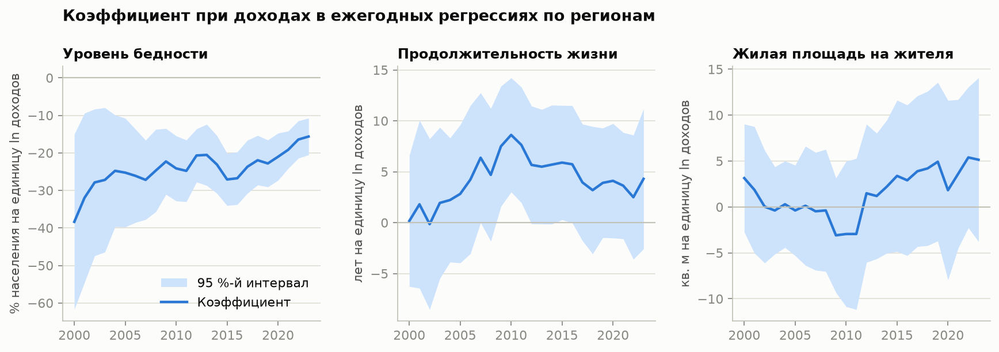

**Трактовка.** Коэффициент при доходах в модели бедности отрицателен и значим в 24 годах из 24, но по модулю
уменьшается: с −38,4 в 2000 году до −15,6 в 2023-м.
Причина — в форме связи: когда бедность была около 40 %, тот же прирост доходов снимал больше процентных
пунктов, чем при бедности около 10 %. Для продолжительности жизни коэффициент значим в 4 годах из 24,
для жилой площади — в 0 из 24: устойчивой связи нет.

## 8. Панельная регрессия

### 8.1. Зачем нужна панельная модель

Регрессия на срезе сравнивает регионы между собой. Но регионы различаются множеством постоянных
особенностей — климатом, географией, структурой экономики, демографией, — которые влияют и на экономику,
и на социальные показатели. Если их не учесть, их влияние приписывается факторам модели (смещение
из-за пропущенных переменных). Панельные данные позволяют убрать эти особенности, даже не измеряя их.

### 8.2. Модель с фиксированными эффектами

$$
y_{it} = \alpha_i + \lambda_t + \beta_1\ln x_{1,it} + \beta_2\ln x_{2,it} + \beta_3\ln x_{3,it} + \boldsymbol\gamma^{\top}\mathbf{z}_{it} + \varepsilon_{it}
$$

- $\alpha_i$ — фиксированный эффект региона: всё, что отличает регион $i$ и не меняется во времени;
- $\lambda_t$ — фиксированный эффект года: всё, что в году $t$ одинаково затронуло все регионы
  (кризисы, пандемия, федеральная политика, смена методики Росстата);
- $\mathbf{z}_{it}$ — контрольные переменные: безработица, врачи, доля горожан, доля пожилых.

Оценка эквивалентна МНК после «внутригруппового» преобразования — вычитания средних по региону и по году:

$$
\ddot{y}_{it} = y_{it} - \bar{y}_{i\cdot} - \bar{y}_{\cdot t} + \bar{y}
$$

Поэтому $\beta$ отвечает на другой вопрос, чем в разделе 7: не «отличаются ли богатые регионы от бедных»,
а **«когда в регионе фактор растёт быстрее, чем в среднем по стране, меняется ли социальный показатель
быстрее, чем в среднем по стране»**. Это гораздо ближе к причинной связи.

Значимость фиксированных эффектов проверяется F-критерием, сравнивающим суммы квадратов остатков
объединённой модели ($RSS_P$) и модели с эффектами ($RSS_{FE}$), где $q$ — число добавленных эффектов:

$$
F = \frac{(RSS_P - RSS_{FE})/q}{RSS_{FE}/(N - q - k - 1)}
$$

Наблюдения одного региона за разные годы не независимы, поэтому стандартные ошибки кластеризованы
по регионам ($G$ — число регионов, $\hat{\mathbf{u}}_g$ — остатки региона $g$):

$$
\widehat{V}(\hat{\boldsymbol\beta}) = (X^{\top}X)^{-1}\left(\sum_{g=1}^{G} X_g^{\top}\hat{\mathbf{u}}_g\hat{\mathbf{u}}_g^{\top}X_g\right)(X^{\top}X)^{-1}
$$

Качество объяснения измеряется «внутригрупповым» $R^2$ — долей разброса, объяснённой факторами
сверх фиксированных эффектов:

$$
R^2_{\text{внутр}} = 1 - \frac{RSS_{FE}}{RSS_{\alpha,\lambda}}
$$

где $RSS_{\alpha,\lambda}$ — сумма квадратов остатков модели, содержащей только эффекты. Обычный $R^2$
у таких моделей близок к единице просто из-за сотни фиктивных переменных и о силе факторов не говорит.

Оценены четыре спецификации:

| Модель | Спецификация |
|---|---|
| `naive` | факторы в текущих ценах + линейный тренд, без эффектов |
| `real` | то же в реальных ценах |
| `fe` | реальные цены + эффекты региона и года |
| `fe_controls` | то же + контрольные переменные |

### 8.3. Нужны ли фиксированные эффекты и кластеризация

**Таблица 17. Тесты спецификации**

| Модель | F | Степени свободы | p | Бройш — Паган, p | Автокорреляция остатков |
|---|---:|---:|---:|---:|---:|
| Уровень бедности | 27,7 | 104; 1816 | <0,001 | <0,001 | 0,86 |
| Продолжительность жизни | 415,8 | 104; 1820 | <0,001 | <0,001 | 0,74 |
| Жилая площадь | 194,1 | 104; 1820 | <0,001 | <0,001 | 0,90 |

**Трактовка.** F-критерий отвергает гипотезу об отсутствии эффектов для всех трёх показателей с огромным
запасом: постоянные особенности регионов и общие годовые шоки существенны, и модель без них смещена.
Тест Бройша — Пагана отвергает гомоскедастичность, а остатки соседних лет одного региона коррелируют
с коэффициентом 0,74–0,90. Обычные стандартные ошибки при такой
автокорреляции занижены в разы, поэтому кластеризация по регионам обязательна.

**Фиксированные или случайные эффекты.** Модель со случайными эффектами точнее, но состоятельна только
если особенности регионов $\alpha_i$ не коррелируют с факторами. Это проверяет тест Мундлака — аналог теста
Хаусмана, применимый при кластеризованных ошибках. В модель без эффектов региона добавляются средние
значения факторов по региону $\bar{\mathbf{x}}_i$:

$$
y_{it} = \lambda_t + \boldsymbol\beta^{\top}\mathbf{x}_{it} + \boldsymbol\delta^{\top}\bar{\mathbf{x}}_{i} + u_{it},
\qquad H_0\colon\ \boldsymbol\delta = \mathbf{0}
$$

Если $\boldsymbol\delta$ значимо отличается от нуля, случайные эффекты несостоятельны.

**Структурный сдвиг.** Чтобы проверить, одинаковы ли коэффициенты в первой и второй половине периода,
факторы дополнительно включаются в произведении с индикатором $D_t$ ($D_t = 1$ с 2012 года):

$$
y_{it} = \alpha_i + \lambda_t + \boldsymbol\beta^{\top}\mathbf{x}_{it} + \boldsymbol\theta^{\top}(D_t\,\mathbf{x}_{it})
+ \boldsymbol\gamma^{\top}\mathbf{z}_{it} + \varepsilon_{it}, \qquad H_0\colon\ \boldsymbol\theta = \mathbf{0}
$$

Обе гипотезы — линейные ограничения на коэффициенты — проверяются F-критерием в форме Вальда
с кластеризованной ковариационной матрицей $\widehat{V}$ ($q$ — число ограничений, $R$ — матрица ограничений):

$$
F = \frac{(R\hat{\boldsymbol\beta})^{\top}\,[R\,\widehat{V}\,R^{\top}]^{-1}\,(R\hat{\boldsymbol\beta})}{q}
$$

**Таблица 18. Выбор типа эффектов и устойчивость коэффициентов во времени**

| Модель | Мундлак: F | p | Сдвиг 2012 г.: F | p  | β доходов до 2012 | β доходов с 2012 |
|---|---:|---:|---:|---:|---:|---:|
| Уровень бедности | 2,68 | 0,052 | 20,63 | <0,001 | −35,85 | −21,26 |
| Продолжительность жизни | 1,94 | 0,130 | 2,61 | 0,057 | −0,22 | −1,74 |
| Жилая площадь | 1,19 | 0,318 | 0,80 | 0,496 | 2,12 | 0,12 |

**Трактовка.** Тест Мундлака не отвергает нулевую гипотезу на уровне 5 % ни для одной модели (для бедности — на границе: p = 0,052). Формально это допускает модель со случайными эффектами. Модель с фиксированными эффектами выбрана как более осторожная: она состоятельна
при любом характере связи между особенностями регионов и факторами, тогда как модель со случайными эффектами —
только при её отсутствии; цена выбора — несколько более широкие доверительные интервалы.
Гипотеза о постоянстве коэффициентов отвергается для моделей: бедности; не отвергается
для моделей: продолжительности жизни, жилой площади. Для бедности коэффициент при доходах до 2012 года равен
−35,8, с 2012 года — −21,3:
эффект в процентных пунктах ослаб на 41 %. Причина разобрана в разделе 8.6 — это следствие степенной
формы связи, а не исчезновения закономерности.

### 8.4. Оценки

В скобках — кластеризованные стандартные ошибки; `***` p < 0,01, `**` p < 0,05, `*` p < 0,1.

**Таблица 19. Уровень бедности, % населения**

| Переменная | `naive` | `real` | `fe` | `fe_controls` |
|---|---:|---:|---:|---:|
| ln ВРП | 0,280 (1,689) | 2,080 (1,387) | 1,779 (1,781) | 1,048 (1,552) |
| ln инвестиций | 0,540 (1,373) | 0,097 (1,193) | −0,499 (0,710) | −0,429 (0,711) |
| ln доходов | −15,236*** (1,788) | −28,115*** (2,260) | −33,488*** (3,404) | −32,729*** (3,518) |
| Год (тренд) | 0,833*** (0,194) | −0,159** (0,069) |  |  |
| Безработица, % |  |  |  | 0,036 (0,131) |
| Врачи на 10 тыс. |  |  |  | 0,049 (0,082) |
| Горожане, % |  |  |  | −0,257** (0,123) |
| Пожилые, % |  |  |  | 0,127 (0,269) |
| Наблюдений | 1924 | 1924 | 1924 | 1924 |
| R² | 0,725 | 0,838 | 0,935 | 0,936 |
| R² внутригрупповой | — | — | 0,567 | 0,575 |

**Таблица 20. Ожидаемая продолжительность жизни, лет**

| Переменная | `naive` | `real` | `fe` | `fe_controls` |
|---|---:|---:|---:|---:|
| ln ВРП | −2,457** (1,218) | −2,483** (1,133) | 0,227 (0,376) | 0,135 (0,370) |
| ln инвестиций | 0,184 (0,831) | 0,030 (0,759) | −0,119 (0,184) | −0,097 (0,174) |
| ln доходов | 2,098** (1,009) | 3,098*** (1,122) | −0,699 (0,529) | −0,780 (0,576) |
| Год (тренд) | 0,430*** (0,110) | 0,388*** (0,041) |  |  |
| Безработица, % |  |  |  | 0,038*** (0,014) |
| Врачи на 10 тыс. |  |  |  | 0,032* (0,018) |
| Горожане, % |  |  |  | −0,029 (0,034) |
| Пожилые, % |  |  |  | −0,066 (0,066) |
| Наблюдений | 1928 | 1928 | 1928 | 1928 |
| R² | 0,525 | 0,526 | 0,969 | 0,970 |
| R² внутригрупповой | — | — | 0,010 | 0,042 |

**Таблица 21. Жилая площадь на одного жителя, кв. м**

| Переменная | `naive` | `real` | `fe` | `fe_controls` |
|---|---:|---:|---:|---:|
| ln ВРП | 3,724** (1,456) | 3,604** (1,400) | −0,929 (0,798) | −1,066 (0,808) |
| ln инвестиций | −1,217 (0,784) | −1,261 (0,771) | −0,849*** (0,236) | −0,832*** (0,238) |
| ln доходов | −1,700 (1,138) | −0,458 (1,363) | 1,550 (0,965) | 1,619 (1,023) |
| Год (тренд) | 0,290*** (0,110) | 0,332*** (0,050) |  |  |
| Безработица, % |  |  |  | 0,035 (0,038) |
| Врачи на 10 тыс. |  |  |  | 0,036 (0,026) |
| Горожане, % |  |  |  | 0,054 (0,061) |
| Пожилые, % |  |  |  | 0,035 (0,118) |
| Наблюдений | 1928 | 1928 | 1928 | 1928 |
| R² | 0,465 | 0,473 | 0,943 | 0,944 |
| R² внутригрупповой | — | — | 0,058 | 0,076 |

### 8.5. Трактовка коэффициентов

Коэффициент при логарифме удобнее читать как эффект роста фактора на 10 %: $\Delta y = \beta\cdot\ln 1{,}1 \approx 0{,}095\,\beta$.

**Таблица 22. Изменение показателя при росте фактора на 10 %** (модель `fe_controls`)

| Показатель | Фактор | Эффект | 95 %-й интервал | p |
|---|---|---:|---:|---:|
| Уровень бедности | ВРП | +0,100 | от −0,190 до +0,390 | 0,499 |
| Уровень бедности | инвестиций | −0,041 | от −0,174 до +0,092 | 0,547 |
| Уровень бедности | доходов | −3,119 | от −3,777 до −2,462 | <0,001 |
| Продолжительность жизни | ВРП | +0,013 | от −0,056 до +0,082 | 0,714 |
| Продолжительность жизни | инвестиций | −0,009 | от −0,042 до +0,023 | 0,576 |
| Продолжительность жизни | доходов | −0,074 | от −0,182 до +0,033 | 0,176 |
| Жилая площадь | ВРП | −0,102 | от −0,253 до +0,049 | 0,187 |
| Жилая площадь | инвестиций | −0,079 | от −0,124 до −0,035 | <0,001 |
| Жилая площадь | доходов | +0,154 | от −0,037 до +0,345 | 0,113 |

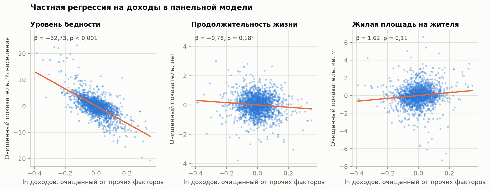

Частный график регрессии показывает ту самую связь, которую оценивает $\beta_3$: и показатель, и логарифм
доходов очищены от остальных факторов и фиксированных эффектов (теорема Фриша — Во — Ловелла),
наклон линии равен коэффициенту модели.

**Бедность.** Связь с доходами сохраняется при самом строгом контроле: β = −32,73
(p < 0,001). Если реальные доходы в регионе растут на 10 % сверх
общероссийской динамики, уровень бедности в нём снижается на **3,1 п. п.**
(95 %-й интервал: от 2,5 до 3,8).
Факторы объясняют 57 % внутригрупповой вариации — много
для модели, из которой уже убраны все постоянные различия и общий тренд. ВРП и инвестиции незначимы:
положительный коэффициент при инвестициях из раздела 7 был артефактом сравнения разных регионов.
Сравнение столбцов показывает цену наивного подхода: модель в текущих ценах занижала эффект доходов
более чем вдвое (−15,2 против −32,7).
В текущих ценах изменение логарифма доходов складывается из реального роста и инфляции; инфляция с бедностью
не связана и «разбавляет» коэффициент.

**Продолжительность жизни.** В моделях без эффектов доходы «значимо» увеличивают продолжительность жизни
(β = 3,10, p = 0,006), а ВРП — «значимо» сокращает.
С фиксированными эффектами оба результата исчезают: коэффициенты близки к нулю и незначимы,
внутригрупповой R² равен 0,010. Прежняя значимость была ложной:
доходы и продолжительность жизни просто росли одновременно. Экономическая динамика региона
объясняет около 1 % того, как менялась продолжительность жизни в нём
относительно страны. Из контрольных переменных значимы безработица и (на уровне 10 %) число врачей,
но положительный знак при безработице содержательного объяснения не имеет.

**Жилая площадь.** Внутригрупповой R² = 0,076. Единственный значимый
коэффициент — отрицательный при инвестициях (−0,83, p < 0,001):
в годы инвестиционного подъёма обеспеченность жильём в регионе растёт медленнее. Возможное объяснение —
приток населения в такие регионы, при котором жилая площадь делится на большее число жителей;
проверить его в рамках этих данных нельзя. Обеспеченность жильём растёт во всех регионах почти независимо
от их экономической динамики.

### 8.6. Модель с постоянной эластичностью для бедности

Разделы 6 и 7 показали, что связь бедности с доходами степенная. В панельной форме ей соответствует
модель с логарифмом бедности в левой части, где $\beta_3$ — эластичность:

$$
\ln y_{1,it} = \alpha_i + \lambda_t + \beta_1\ln x_{1,it} + \beta_2\ln x_{2,it} + \beta_3\ln x_{3,it} + \boldsymbol\gamma^{\top}\mathbf{z}_{it} + \varepsilon_{it}
$$

**Таблица 23. Эластичность бедности по реальным доходам**

| Период | Эластичность | Ст. ош. | 95 %-й интервал | Средняя бедность, % | n |
|---|---:|---:|---:|---:|---:|
| 2000–2023 гг. | −1,178 | 0,104 | от −1,38 до −0,97 | 19,0 | 1924 |
| 2000–2011 гг. | −1,244 | 0,097 | от −1,43 до −1,05 | 24,3 | 946 |
| 2012–2023 гг. | −1,010 | 0,100 | от −1,21 до −0,81 | 13,7 | 978 |

**Трактовка.** Рост реальных доходов на 1 % снижает уровень бедности на 1,18 %. В отличие
от коэффициента в п. п., эластичность почти одинакова в обе половины периода
(−1,24 и −1,01): закономерность устойчива, а снижение эффекта в процентных
пунктах объясняется только тем, что сама бедность стала ниже. Практический смысл: при бедности 10 %
рост доходов на 10 % снижает её примерно на 1,2 п. п., при бедности 30 % — на 3,5 п. п.

### 8.7. Проверка устойчивости

Вывод надёжен, если он не зависит от частных решений исследователя. Коэффициент при ln доходов
переоценён на разных выборках и в альтернативной спецификации — в первых разностях:

$$
\Delta y_{it} = \lambda_t + \beta_1\Delta\ln x_{1,it} + \beta_2\Delta\ln x_{2,it} + \beta_3\Delta\ln x_{3,it} + \boldsymbol\gamma^{\top}\Delta\mathbf{z}_{it} + \Delta\varepsilon_{it}
$$

**Таблица 24. Коэффициент при ln доходов в разных вариантах модели**

| Вариант | Уровень бедности | Продолжительность жизни | Жилая площадь |
|---|---:|---:|---:|
| Базовая модель | −32,73*** (3,52) | −0,78 (0,58) | 1,62 (1,02) |
| 2000–2011 гг. | −39,34*** (3,60) | −0,89* (0,50) | 1,14 (0,85) |
| 2012–2023 гг. | −14,63*** (1,69) | 0,30 (0,62) | −1,06 (1,48) |
| Без 2020–2021 гг. | −33,18*** (3,52) | −0,88 (0,56) | 1,56 (1,02) |
| Без регионов-лидеров | −35,21*** (3,21) | −1,04 (0,66) | 1,14 (0,81) |
| Без Северного Кавказа | −29,00*** (3,25) | −0,42 (0,59) | 1,88 (1,16) |
| Факторы с лагом в один год | −25,84*** (3,47) | −0,82 (0,63) | 1,92** (0,97) |
| Первые разности | −28,63*** (1,71) | −0,40 (0,38) | −0,52 (0,38) |

**Трактовка.** Для бедности коэффициент отрицателен и значим на уровне 1 % во всех 8 вариантах,
в диапазоне от −39,3 до −14,6. Результат не держится на регионах-лидерах,
Северном Кавказе или пандемийных годах и сохраняется, когда доходы берутся с лагом в один год — то есть
доходы предыдущего года предсказывают бедность следующего, что ослабляет подозрение в обратной причинности.
Различие между периодами — следствие формы связи (раздел 8.6).
Для продолжительности жизни коэффициент незначим на уровне 5 % во всех вариантах
(наименьшее p = 0,076). Для жилой площади знак меняется от варианта к варианту
(от −1,1 до 1,9), значим он в 1 случае из 8: устойчивой связи нет.

### 8.8. Диагностика остатков

**Таблица 25. Остатки модели `fe_controls`**

| Модель | Ст. откл. остатков | Асимметрия | Эксцесс | Харке — Бера | p |
|---|---:|---:|---:|---:|---:|
| Уровень бедности | 2,74 | 0,67 | 4,71 | 1 926 | <0,001 |
| Продолжительность жизни | 0,67 | 0,00 | 2,84 | 647 | <0,001 |
| Жилая площадь | 1,04 | −0,32 | 6,99 | 3 960 | <0,001 |

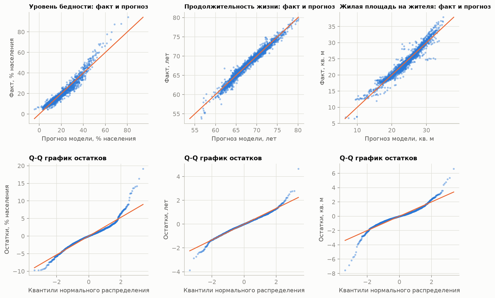

**Трактовка.** Для продолжительности жизни и жилой площади остатки расположены вокруг нуля без заметного
рисунка. Для бедности рисунок есть: остатки положительны при самых низких и самых высоких прогнозах
и отрицательны в середине, а их разброс растёт с уровнем прогноза. Модель в процентных пунктах занижает
бедность на краях — это след степенной связи, которую прямая в полулогарифмических координатах описывает
лишь приближённо. У всех трёх моделей тяжёлые хвосты (эксцесс больше нуля, на Q-Q графике концы отходят
от прямой): в отдельные годы в отдельных регионах показатели резко отклонялись от прогноза. Тест Харке — Бера
нормальность отвергает. На состоятельность оценок это не влияет, а значимость при 1924
наблюдениях и 82 кластерах опирается на асимптотическую нормальность оценок,
а не на нормальность остатков. Рисунок остатков модели бедности — ещё один довод в пользу
логарифмической спецификации из раздела 8.6.

## 9. Типология регионов

### 9.1. Методика

Регрессии описывают средние закономерности. Кластерный анализ отвечает на другой вопрос: какие типы
регионов существуют. Используются девять показателей последнего года; ВРП и доходы берутся в логарифмах.
Чтобы показатели в разных единицах имели равный вес, они стандартизуются:

$$
z_{ij} = \frac{x_{ij}-\bar{x}_j}{s_j}
$$

Метод k-средних делит регионы на $k$ групп $S_1,\dots,S_k$ так, чтобы суммарное расстояние от регионов
до центров своих кластеров $\boldsymbol\mu_c$ было наименьшим:

$$
W(k) = \sum_{c=1}^{k}\sum_{i\in S_c}\lVert \mathbf{z}_i-\boldsymbol\mu_c\rVert^{2} \to \min
$$

Число кластеров выбирается по двум критериям. Метод «локтя»: $W(k)$ всегда убывает с ростом $k$, выбирается
точка, после которой убывание замедляется. Коэффициент силуэта для региона $i$:

$$
s_i = \frac{b_i-a_i}{\max(a_i,\,b_i)}
$$

где $a_i$ — среднее расстояние до регионов своего кластера, $b_i$ — до регионов ближайшего чужого.
Среднее $s_i$ близко к 1 при чётко разделённых кластерах и к 0 при размытых границах.

Для наглядности девять показателей сворачиваются в главные компоненты — некоррелированные линейные
комбинации, вбирающие наибольшую долю общей дисперсии. Значимость различий между кластерами по каждому
показателю проверяется ранговым критерием Краскела — Уоллиса ($H_0$: распределения в кластерах одинаковы).

### 9.2. Выбор числа кластеров

**Таблица 26. Критерии выбора k**

| k | W(k) | Снижение W, % | Силуэт |
|---|---:|---:|---:|
| 2 | 517 | 30 | 0,457 |
| 3 | 395 | 24 | 0,397 |
| 4 | 342 | 13 | 0,369 |
| 5 | 299 | 13 | 0,196 |
| 6 | 267 | 11 | 0,194 |
| 7 | 244 | 9 | 0,201 |

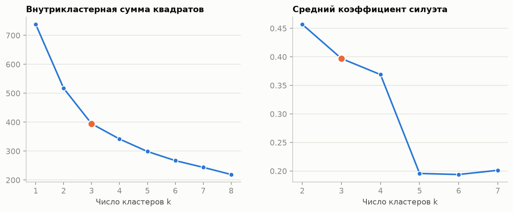

**Трактовка.** Переход от двух кластеров к трём снижает $W$ на 24 %, от трёх к четырём —
уже на 13 %: «локоть» приходится на k = 3. Силуэт максимален при k = 2 (0,46),
но такое деление лишь отделяет бедные республики от всех остальных; при k = 3 он немного ниже (0,40),
а при k = 5 резко падает (0,20). Выбрано **k = 3**. Значения силуэта около 0,4 говорят о том,
что границы между типами размыты: это не изолированные группы, а участки непрерывного распределения.

### 9.3. Главные компоненты

**Таблица 27. Нагрузки показателей на главные компоненты** (в скобках — доля объяснённой дисперсии)

| Показатель | ГК1 (47 %) | ГК2 (22 %) | ГК3 (12 %) |
|---|---:|---:|---:|
| ВРП на душу | −0,39 | −0,30 | −0,14 |
| Доходы на душу | −0,39 | −0,34 | +0,05 |
| Уровень бедности | +0,44 | −0,04 | −0,27 |
| Продолжительность жизни | +0,13 | −0,11 | +0,90 |
| Жилая площадь | −0,29 | +0,46 | +0,09 |
| Безработица | +0,38 | −0,24 | +0,20 |
| Врачи на 10 тыс. | −0,22 | −0,48 | +0,08 |
| Доля горожан | −0,38 | −0,11 | +0,03 |
| Доля пожилых | −0,27 | +0,53 | +0,20 |

**Трактовка.** Три компоненты вбирают 80 % общей дисперсии девяти показателей.
Первая (47 %) — ось «уровень развития»: на одном полюсе высокие ВРП, доходы и урбанизация,
на другом — бедность и безработица. Вторая (22 %) — демографическая: стареющие регионы
с большим жилым фондом на человека против молодых и богатых с высокой обеспеченностью врачами.
Третья (12 %) почти целиком состоит из продолжительности жизни (нагрузка +0,90):
этот показатель образует **отдельное измерение**, не связанное ни с уровнем развития, ни с демографической
структурой, — тот же вывод, к которому привели регрессии.

### 9.4. Профили кластеров

**Таблица 28. Средние значения показателей по кластерам, 2023 г.**

| Кластер | Регионов | Доходы, руб. | ВРП, руб. | Бедность, % | Жизнь, лет | Жильё, кв. м | Безраб., % | Врачи | Горожане, % | Пожилые, % |
|---|---:|---:|---:|---:|---:|---:|---:|---:|---:|---:|
| 1 | 9 | 70 963 | 2 130 660 | 7,3 | 72,4 | 27,2 | 2,8 | 68,8 | 85,4 | 19,9 |
| 2 | 63 | 45 364 | 777 538 | 10,1 | 72,1 | 30,8 | 3,2 | 48,1 | 72,2 | 24,8 |
| 3 | 10 | 35 224 | 404 552 | 18,1 | 74,2 | 21,7 | 9,8 | 44,8 | 47,6 | 16,4 |

- **Кластер 1** (9): Камчатский край, Магаданская область, Мурманская область, Республика Саха (Якутия), Сахалинская область, Тюменская область, Чукотский автономный округ, г. Москва, г. Санкт-Петербург.
- **Кластер 2** (63): Алтайский край, Амурская область, Архангельская область, Астраханская область, Белгородская область, Брянская область, Владимирская область, Волгоградская область, Вологодская область, Воронежская область, Еврейская автономная область, Забайкальский край, Ивановская область, Иркутская область, Калининградская область, Калужская область, Кемеровская область, Кировская область, Костромская область, Краснодарский край, Красноярский край, Курганская область, Курская область, Ленинградская область, Липецкая область, Московская область, Нижегородская область, Новгородская область, Новосибирская область, Омская область, Оренбургская область, Орловская область, Пензенская область, Пермский край, Приморский край, Псковская область, Республика Адыгея, Республика Башкортостан, Республика Карелия, Республика Коми, Республика Марий Эл, Республика Мордовия, Республика Северная Осетия – Алания, Республика Татарстан, Республика Хакасия, Ростовская область, Рязанская область, Самарская область, Саратовская область, Свердловская область, Смоленская область, Ставропольский край, Тамбовская область, Тверская область, Томская область, Тульская область, Удмуртская Республика, Ульяновская область, Хабаровский край, Челябинская область, Чувашская Республика, Ярославская область, г. Севастополь.
- **Кластер 3** (10): Кабардино-Балкарская Республика, Карачаево-Черкесская Республика, Республика Алтай, Республика Бурятия, Республика Дагестан, Республика Ингушетия, Республика Калмыкия, Республика Крым, Республика Тыва, Чеченская Республика.

**Таблица 29. Критерий Краскела — Уоллиса: различаются ли кластеры**

| Показатель | H | p |
|---|---:|---:|
| ВРП на душу | 38,2 | <0,001 |
| Доходы на душу | 35,2 | <0,001 |
| Уровень бедности | 28,7 | <0,001 |
| Продолжительность жизни | 2,7 | 0,264 |
| Жилая площадь | 29,0 | <0,001 |
| Безработица | 24,6 | <0,001 |
| Врачи на 10 тыс. | 22,2 | <0,001 |
| Доля горожан | 31,9 | <0,001 |
| Доля пожилых | 27,4 | <0,001 |

**Трактовка.**

- **Кластер 1 — лидеры.** Столицы и ресурсные регионы Севера и Дальнего Востока: ВРП на душу в 2,7 раза
  выше, чем в основной группе, доходы — в 1,6 раза, самая низкая бедность
  и самая высокая обеспеченность врачами. При этом жилья на человека меньше, чем в основной группе.
- **Кластер 2 — основная группа.** Три четверти регионов страны: средние доходы, умеренная бедность,
  самое старое население и самая высокая обеспеченность жильём.
- **Кластер 3 — отстающие.** Республики Северного Кавказа и юга Сибири, Крым: доходы на 22 %
  ниже основной группы, бедность почти вдвое выше, безработица втрое выше, молодое и преимущественно
  сельское население, меньше всего жилья на человека.

Кластеры значимо различаются по всем показателям, кроме: продолжительность жизни.
Различие средней продолжительности жизни между кластерами (72,4, 72,1
и 74,2 года) статистически незначимо: богатые и бедные типы регионов по ней не отличаются.

## 10. Обсуждение результатов

### 10.1. Проверка гипотез

| Гипотеза | Результат | Основание |
|---|---|---|
| **H1.** Экономические факторы снижают бедность, сильнее всего — доходы | **Подтверждена для доходов**, не подтверждена для ВРП и инвестиций | Эластичность −1,18, значима во всех вариантах модели; ВРП и инвестиции незначимы при контроле доходов |
| **H2.** Экономические факторы повышают продолжительность жизни | **Не подтверждена** | Внутригрупповой R² 0,01; коэффициенты незначимы во всех вариантах |
| **H3.** Экономические факторы повышают обеспеченность жильём | **Не подтверждена** | Внутригрупповой R² 0,08; знак коэффициента при доходах неустойчив |
| **H4.** Регионы сближаются | **Подтверждена частично** | β-сходимость по доходам (b = −0,021, p < 0,001); по ВРП сходимости нет |

### 10.2. Что это означает

**Важен не объём экономики региона, а доходы его жителей.** ВРП и инвестиции связаны с бедностью только
постольку, поскольку связаны с доходами; сами по себе они ничего не добавляют. Одновременно доходы регионов
сближались, а ВРП — нет. Вместе эти два результата означают, что снижение бедности в отстающих регионах
опиралось не на рост их собственного производства, а на рост доходов, который от производства был
частично отвязан.

**Социальное благополучие не одномерно.** Ранжирования регионов по бедности, продолжительности жизни
и жилью не согласованы между собой (коэффициент конкордации 0,42, p = 0,064),
тогда как по трём экономическим показателям согласованность высокая (0,81). Экономика региона —
одно измерение, социальная сфера — несколько независимых.

**Продолжительность жизни живёт по своим законам.** Она выросла во всех регионах, но регионы, богатевшие
быстрее, не получили преимущества. Самые бедные республики остаются среди лидеров, самые богатые северные
регионы — среди отстающих. В данных исследования нет переменных, которые обычно называют определяющими, —
образа жизни, потребления алкоголя, климата, качества (а не количества) медицинской помощи; часть из них
постоянна и ушла в фиксированные эффекты региона.

**Обеспеченность жильём определяется демографией сильнее, чем экономикой.** Больше всего жилья на человека
там, где население убывает и стареет, а не там, где высокие доходы.

**Простая регрессия по объединённым данным вводит в заблуждение.** Она давала «значимый» положительный
эффект доходов на продолжительность жизни и R² выше 0,5. Обе цифры — следствие общего тренда.
Этот результат важен сам по себе: высокий R² и значимые коэффициенты во временных данных не доказывают связи.

### 10.3. Ограничения

1. **Связь, но не доказанная причинность.** Фиксированные эффекты убирают постоянные особенности регионов
   и общие шоки, но не меняющиеся во времени пропущенные переменные и не обратную причинность.
   Модель с лагом ослабляет, но не снимает это возражение.
2. **Бедность и доходы связаны по определению:** бедность — доля людей с доходами ниже черты. Наличие связи
   ожидаемо; содержательны её величина, устойчивость эластичности и то, что остальные факторы ничего не добавляют.
3. **Изменения методики Росстата:** расчёт доходов с 2013 года, переход от прожиточного минимума к границе
   бедности с 2021 года, учёт жилищного фонда с 2013 года. Общие для всех регионов сдвиги поглощаются
   эффектами года, но если изменения затронули регионы по-разному, оценки могут быть смещены.
4. **Дефлятор приближённый.** Стоимость фиксированного набора измеряется на декабрь и отражает потребительские
   цены; для ВРП и инвестиций точнее были бы индексы-дефляторы, которых в приложении к сборнику нет.
5. **Средние по региону скрывают неравенство внутри него.** Среднедушевой доход Москвы или Тюменской области
   ничего не говорит о распределении; регионы с автономными округами учтены целиком.
6. **Кластеры размыты** (силуэт около 0,4), типология описательная.

## 11. Выводы

1. Из трёх экономических факторов с социальными показателями устойчиво связаны только **доходы населения**,
   и только с **бедностью**: рост реальных доходов на 1 % снижает уровень бедности на 1,2 %,
   рост на 10 % — на 3,1 п. п. в среднем за период. Связь степенная, эластичность стабильна во времени.
2. ВРП и инвестиции на душу населения при тех же доходах с бедностью **не связаны**.
3. **Продолжительность жизни** от экономической динамики региона практически не зависит
   (около 1 % объяснённой вариации) и образует отдельное измерение различий между регионами.
4. **Обеспеченность жильём** растёт повсеместно и определяется демографией, а не экономикой региона.
5. Регионы **сближались по доходам** со скоростью 2,9 % в год до начала 2010-х годов;
   по ВРП сближения не было.
6. Регионы делятся на **три типа**: лидеры (9),
   основная группа (63) и отстающие (10);
   по продолжительности жизни типы между собой значимо не различаются.
7. Методический результат: без пересчёта в реальные цены и без учёта панельной структуры данных
   выводы о роли экономических факторов оказываются ложными.

## Источники

1. Регионы России. Социально-экономические показатели. 2025: приложение к статистическому сборнику /
   Росстат. — М., 2025. — URL: https://rosstat.gov.ru/folder/210/document/47652
2. Магнус Я. Р., Катышев П. К., Пересецкий А. А. Эконометрика. Начальный курс. — М.: Дело.
3. Wooldridge J. M. Econometric Analysis of Cross Section and Panel Data. — 2nd ed. — MIT Press, 2010.
4. Barro R. J., Sala-i-Martin X. Convergence // Journal of Political Economy. — 1992. — Vol. 100, No. 2. — P. 223–251.
5. Cameron A. C., Miller D. L. A Practitioner's Guide to Cluster-Robust Inference // Journal of Human Resources. — 2015. — Vol. 50, No. 2. — P. 317–372.
6. Rousseeuw P. J. Silhouettes: a graphical aid to the interpretation and validation of cluster analysis //
   Journal of Computational and Applied Mathematics. — 1987. — Vol. 20. — P. 53–65.
